<p align="center"></p>
<h1 align="center">Protoboard ISO</h1>
<p align="center"><strong>Circuitos en protoboard para armar, romper y entender, a partir de una frase.</strong><br>Pide un circuito. Míralo armado en la protoboard, hueco por hueco, y funcionando.</p>
<p align="center"><a href="https://ccamilobedoya.github.io/protoboard-iso/es/">Demostración en vivo</a> · <a href="README.md">English</a> · <a href="docs/es/README.md">Documentación</a> · <a href="LICENSE">Licencia MIT</a></p>
<p align="center"><a href="https://github.com/ccamilobedoya/protoboard-iso/actions/workflows/ci.yml"></a> <a href="CHANGELOG.md"></a> <a href="LICENSE"></a> <a href="https://nodejs.org/"></a></p>


## Inicio rápido

Elige una. Cada una toma más o menos un minuto.

### 1. Míralo funcionando

[**Abre la demostración en vivo**](https://ccamilobedoya.github.io/protoboard-iso/es/) en tu navegador. No hay nada que instalar.

### 2. Pídele un circuito a Claude

Sin terminal. En la app de Claude:

1. Abre **Customize → Plugins → Add → Add marketplace** (los nombres del menú, en inglés).
2. Pega `https://github.com/ccamilobedoya/protoboard-iso` e instala **Protoboard ISO**.
3. Pide con tus palabras: *un LED rojo con su resistencia a 9 V*.

La ejecución de código debe estar activada en la app. Para ver la protoboard dentro del chat en
Claude Desktop, [agrega la extensión](docs/es/mcp.md#claude-desktop-con-un-clic).

### 3. Córrelo en tu computador

Necesita [Node.js](https://nodejs.org/) 22 o más nuevo, y nada más.

<!-- smoke -->
```bash
git clone https://github.com/ccamilobedoya/protoboard-iso.git
cd protoboard-iso                      # no hay nada que instalar
node bin/protoboard-iso.js layout mi-led --recipe led-resistor --values '{"R1":"470","D1":"green"}' --lang es
```

Abre en un navegador la página que imprime (`Página: …`). Más comandos, y PowerShell de Windows:
[para desarrolladores](#para-desarrolladores).

## Qué puedes pedir

- «un LED rojo con su resistencia a 9 V»
- «cambia la resistencia a 1k»
- «un LED rojo a 9 V con 15 mA por el LED»
- «un Arduino UNO que haga parpadear un LED, con su programa»
- «¿qué es este componente y cuál pata es cuál?»
- «arréglalo», después de un aviso

El kit hace lo que pides aunque sea mala idea, y te dice qué se quemaría y cómo arreglarlo: así se
aprende.

## Qué obtienes

| | | |
|---|---|---|
| 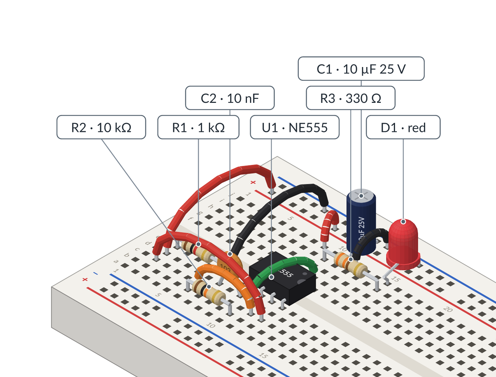<br>**En la protoboard.** Cada componente en agujeros reales, a su tamaño real, con sus cables: cópialo en la tuya. | 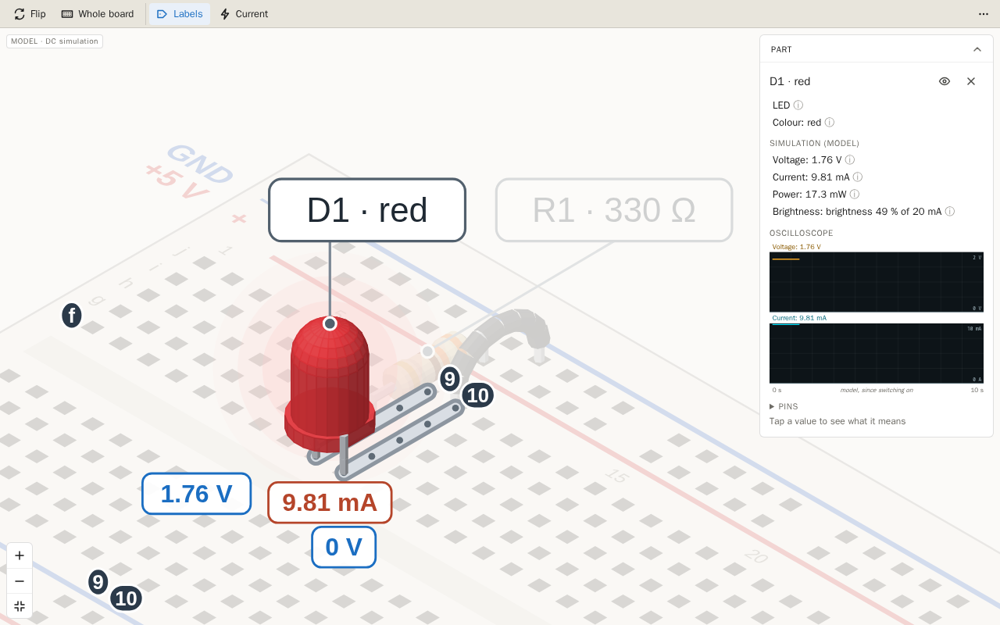<br>**Funcionando.** Una página con la simulación: toca un componente para ver su voltaje, su corriente y su osciloscopio. | 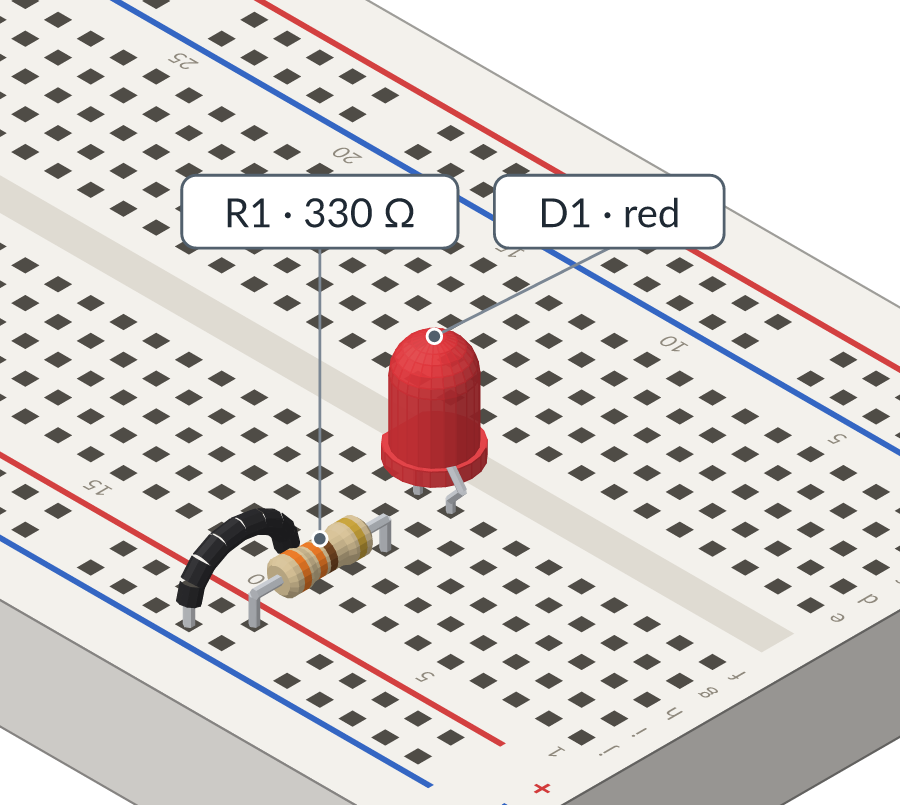<br>**Desde el otro lado.** La protoboard volteada y con etiquetas, para que nada quede escondido detrás de un componente. |

Y una respuesta franca. Un Arduino que alimenta un zumbador directo desde un pin
([el circuito](test/fixtures/kit-first/buzzer-on-pin.json)), tal como lo informa `layout --lang es`:

```text
Revisión (lesson): APROBADO CON AVISOS.
Tal como está conectado, esto dañaría:
  ⚠ aviso: Por U1.D10 pasan 88,3 mA, más que su máximo de 40 mA: el pin se puede dañar, con D9 + D10 en alto.
Para arreglarlo: una resistencia de 200 Ω en serie con BZ1 deja el pin D10 de U1 en 19,4 mA (máximo 40 mA).
```

## Recetas

Los circuitos de lección habituales salen listos por su nombre, solo con los valores que cambias
([todas las recetas](docs/es/recetas.md)):

| | | |
|---|---|---|
| 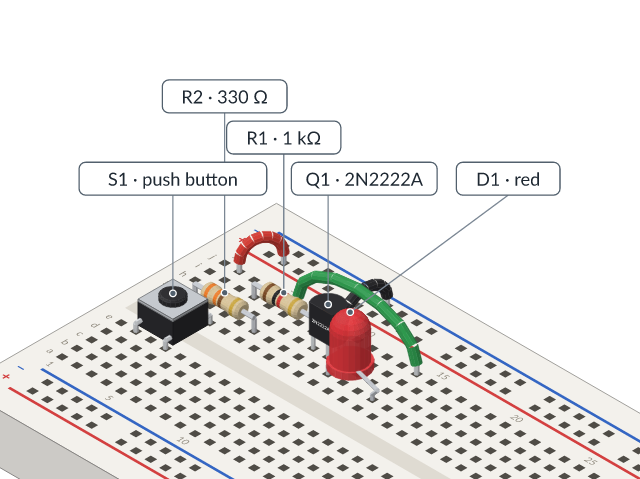<br>`npn-switch`: un pulsador y un transistor encienden un LED | 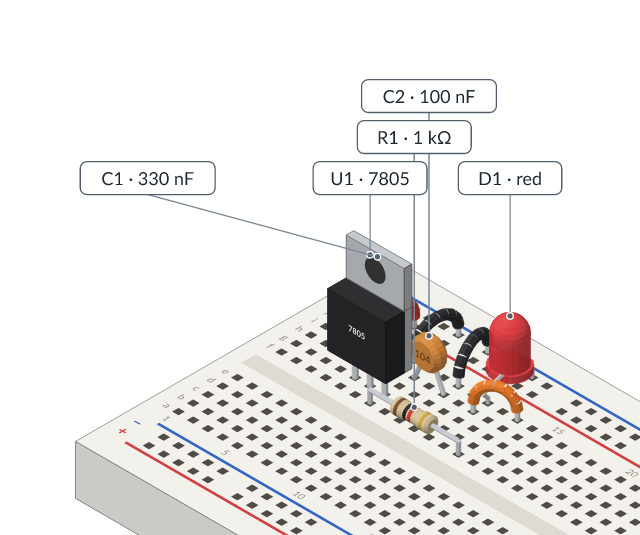<br>`regulator-7805`: un regulador lineal y un LED piloto | 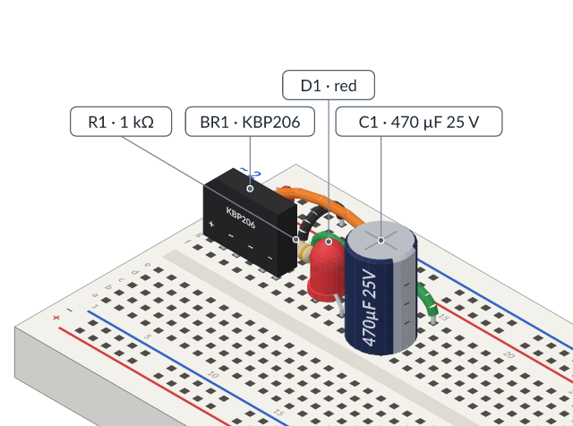<br>`bridge-rectifier`: un puente, un condensador de filtro, una senoidal a la entrada |
| 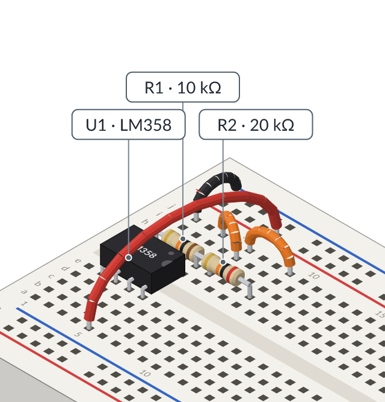<br>`opamp-noninverting`: un amplificador con LM358 | 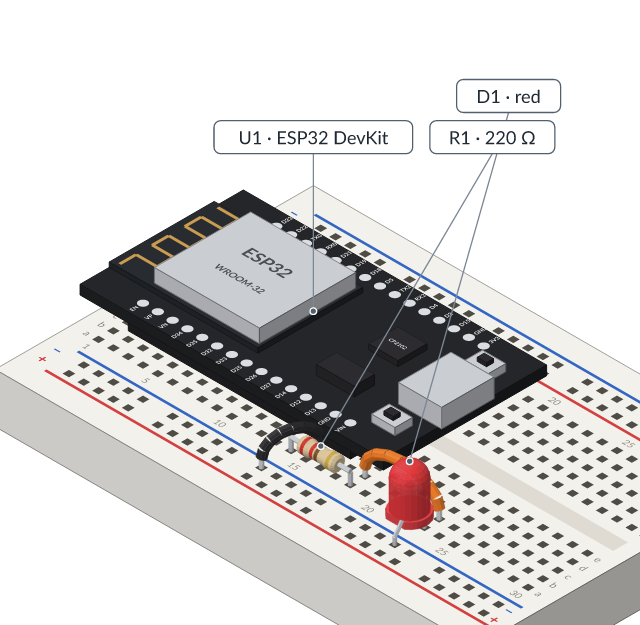<br>`esp32-led`: un ESP32 que corre un programa de parpadeo | 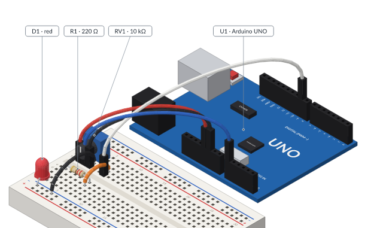<br>`uno-pot-pwm`: un Arduino UNO regula un LED con un potenciómetro |

También: `led-resistor`, `divider`, `potentiometer-led`, `mosfet-switch`, `button-pullup`,
`button-pulldown`, `rc-square`, `555-astable`, `regulator-ams1117`, `zener-regulator`,
`esp32-button`, `opamp-comparator`, `lm393-comparator`, `opamp-follower`, `opamp-inverting`,
`uno-blink`, `uno-button`, `c3-blink`, `c3-pot-pwm`.

Más archivos de circuito, cada uno con lo que muestra: [examples/](examples/README.es.md).

## Cómo funciona

De una descripción a una lección, en seis pasos:

| 1. Describir | 2. Ubicado y dibujado | 3. Revisado |
|---|---|---|
| Un archivo de circuito nombra componentes y agujeros ([formato](docs/es/formato-circuito.md)), o `layout` los ubica a partir de una lista de conexiones ([montaje automático](docs/es/montaje-automatico.md)). | 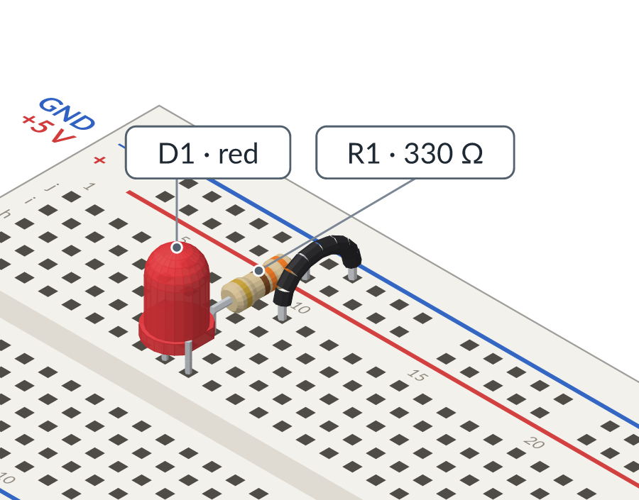 | 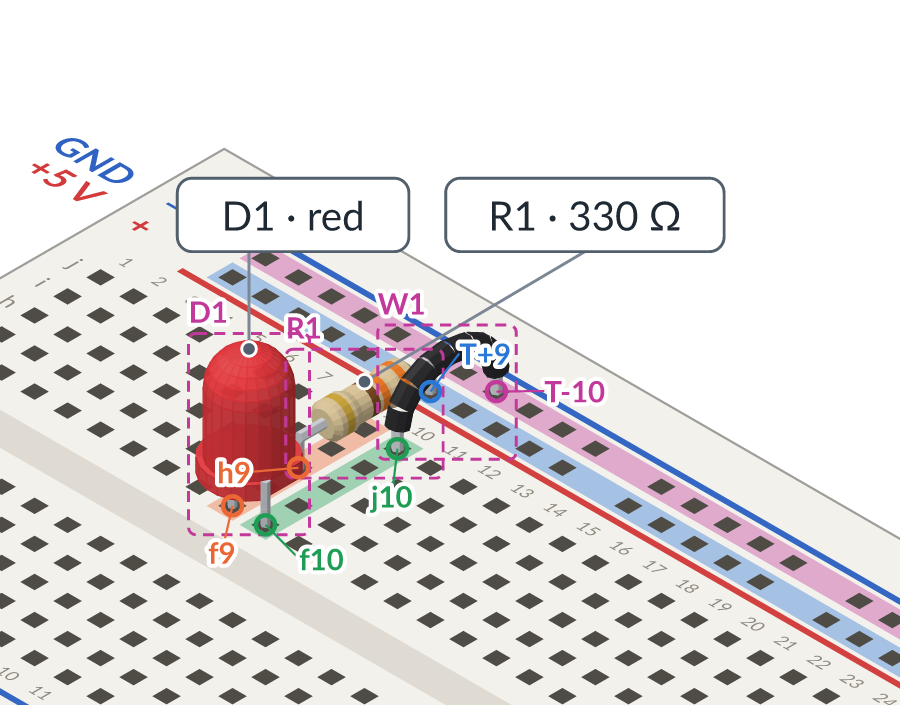 |
| **4. Desde atrás** | **5. Simulado** | **6. Corriente** |
|  | 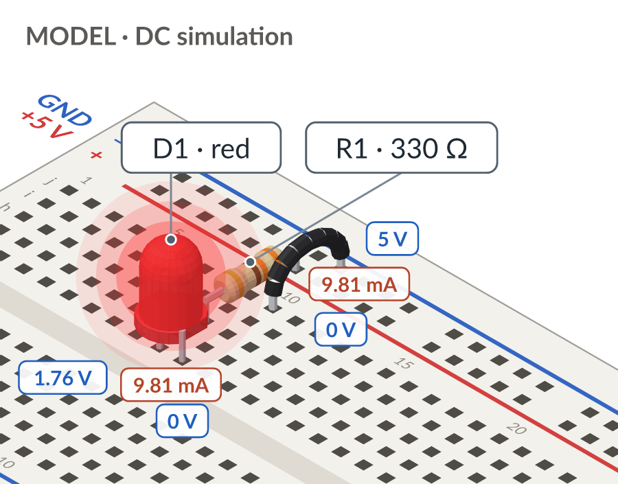 | 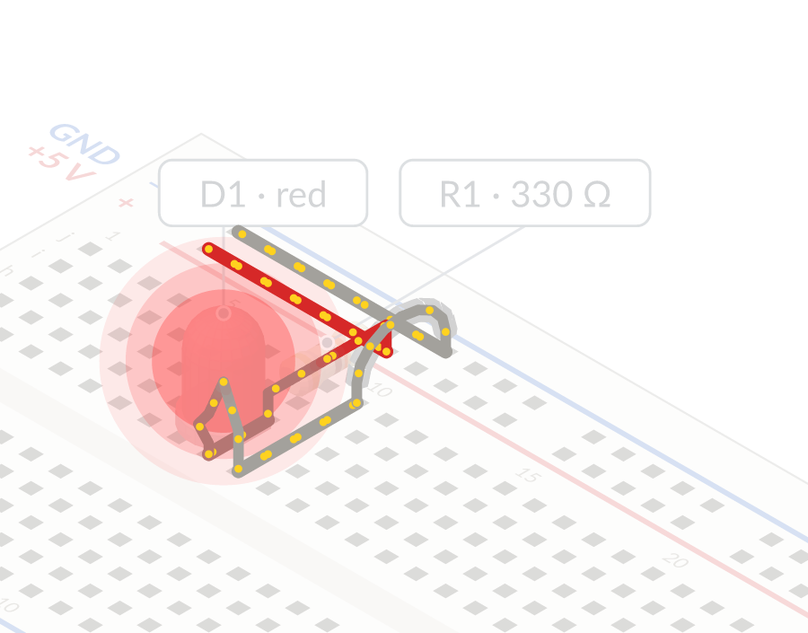 |

El circuito de esas imágenes, [`examples/led-resistor.json`](examples/led-resistor.json) (abreviado):

```json
{
  "title": { "en": "LED with a current-limiting resistor", "es": "LED con resistencia limitadora" },
  "board": "bb830",
  "netLabels": { "T+": "+5 V", "T-": "GND" },
  "supplies": [{ "id": "V1", "voltage": 5, "currentLimit": 0.1 }],
  "parts": [
    { "id": "R1", "type": "resistor", "value": "330", "pins": ["T+9", "h9"] },
    { "id": "D1", "type": "led", "color": "red", "pins": { "anode": "f9", "cathode": "f10" } },
    { "id": "W1", "type": "wire", "color": "black", "pins": ["j10", "T-10"] }
  ]
}
```

Los agujeros son una letra de fila y una columna (`f9`); los rieles son `T+`, `T-`, `B+`, `B-` más
una columna. Las filas a–e de una columna son un nodo, f–j otro, y cada riel uno más: es todo lo
que el kit necesita para saber qué está conectado.

**La página.** Cada circuito tiene `out/<nombre>.html`, un solo archivo sin red ni compilación,
hecho para ir dentro de un iframe o de una app de notas ([embeber](docs/es/embeber.md)). Al tocar
un componente, su ficha muestra sus valores, un osciloscopio y qué significa cada valor; los
deslizadores cambian resistencias, fuentes y sensores mientras corre.

## Para desarrolladores

<details>
<summary><strong>La línea de comandos</strong></summary>

`node bin/protoboard-iso.js <comando>`: `layout`, `check`, `render`, `inspect`, `simulate`, `page`,
`review`, `query`, `suggest`, `apply`, `undo`, `history`. Sin argumentos muestra la lista completa.
Después del circuito de [inicio rápido](#inicio-rápido), `mi-led/` guarda también el circuito
(`circuit.json`) y su historial. Luego:

<!-- smoke -->
```bash
node bin/protoboard-iso.js simulate mi-led --lang es          # voltajes y corrientes, en texto
node bin/protoboard-iso.js render mi-led --view back --lang es # el dibujo desde el otro lado
node bin/protoboard-iso.js review mi-led --lang es             # APROBADO o HAY QUE CAMBIAR, y por qué
```

En Windows PowerShell 5.1 las comillas de `--values` no llegan igual al programa (quita las
comillas dobles internas). Pasa los mismos valores por la entrada estándar, que funciona en
cualquier consola:

```powershell
'{"recipe":"led-resistor","values":{"R1":"470","D1":"green"}}' | node bin/protoboard-iso.js layout mi-led - --lang es
```

[Interfaz para agentes](docs/es/interfaz-para-agentes.md) explica cómo se cambia un circuito con
operaciones en vez de reescribirlo.

</details>

<details>
<summary><strong>El servidor MCP</strong> (Claude Code, Claude Desktop y otros clientes MCP)</summary>

En este repositorio ya lo registra `.mcp.json`; en otro lugar:

```bash
cd mcp && npm install && cd ..
mkdir -p "$HOME/circuits"              # donde se guardan tus circuitos: una carpeta tuya, no este clon
claude mcp add protoboard-iso -e PROTOBOARD_ROOT="$HOME/circuits" -e PROTOBOARD_LANG=es -- node "$PWD/mcp/server.js"
```

Después pide un circuito con palabras («un LED con su resistencia a 9 V»). Instalación,
herramientas y la configuración de Claude Desktop (con rutas de Windows): [docs/es/mcp.md](docs/es/mcp.md).

</details>

<details>
<summary><strong>El plugin y la extensión de escritorio</strong>, en detalle</summary>

**Plugin con el skill** (las apps de Claude y Claude Code). El plugin de [plugin/](plugin/README.md)
trae un skill con el kit adentro: corre donde el asistente ejecuta código, con Node ≥ 22 y nada que
instalar. En la app de Claude, agrega el marketplace con la URL de este repositorio
(`https://github.com/ccamilobedoya/protoboard-iso`) e instala `protoboard-iso`; en Claude Code,
`/plugin marketplace add ccamilobedoya/protoboard-iso` y después
`/plugin install protoboard-iso@protoboard-iso`.

**Extensión de escritorio** (Claude Desktop; opcional, sin terminal). El plugin funciona solo; la
extensión agrega el tablero en vivo dentro de la conversación, donde tocas un componente o mueves
un deslizador. Es el servidor MCP en un solo archivo (`.mcpb`, un MCP Bundle) con todo lo que
necesita. Desde la primera versión publicada, descarga `protoboard-iso-<versión>.mcpb` de las
[versiones publicadas](https://github.com/ccamilobedoya/protoboard-iso/releases), haz doble clic,
elige la carpeta para tus circuitos, enciende la extensión en sus ajustes (se instala apagada) y
pide un circuito. El aviso de instalación sobre el acceso al computador es de la aplicación, con
toda extensión local. Detalles: [Claude Desktop con un clic](docs/es/mcp.md#claude-desktop-con-un-clic).

</details>

<details>
<summary><strong>Como librería</strong>, en Node o en un navegador</summary>

```js
import { renderCircuit } from './src/index.js';
const { svg, issues } = renderCircuit(circuit, { view: 'front', lang: 'es' });
```

</details>

<details>
<summary><strong>Agentes</strong> para trabajar circuitos</summary>

El repositorio trae tres agentes en `.claude/agents/`: uno monta, otro revisa, otro agrega
componentes. Cómo usarlos y sus formatos de encargo: [agentes](docs/es/agentes.md).

</details>

## Qué es y qué no es

- **Dibujado a escala**: resistencias con sus bandas de colores reales, LED, condensadores,
  transistores, reguladores, chips, placas de desarrollo (ESP32, Arduino UNO), baterías. Vista de
  frente y desde atrás.
- **Revisado**: solo con los agujeros el kit sabe qué está conectado, y avisa de tiras en corto,
  agujeros ocupados, patas que no alcanzan y componentes que se montan unos sobre otros.
- **Simulado** (un modelo, y lo dice): voltajes, corrientes, un osciloscopio, LED que se encienden,
  avisos cuando un componente pasa de su límite, y hasta un programa de Arduino corriendo.
- **Hecho para asistentes**: un plugin con un skill (el kit adentro), un servidor MCP y tres
  agentes, para que un asistente de IA describa el circuito y el kit haga la geometría. Nunca
  calcula un agujero a mano.
- **Sin dependencias**: JavaScript simple, Node ≥ 22 o un navegador. En inglés y en español.
- **En uso**: [ohmio.dev](https://ohmio.dev/es/) enseña electrónica con circuitos dibujados y
  simulados por este kit.

Y lo que no es:

- La simulación es un **modelo**, no una medición: cada resultado lo dice. Sirve para ver por qué
  un LED necesita una resistencia o cómo se carga un condensador; no reemplaza a SPICE. Sus
  resultados se comparan caso por caso con [el simulador de Falstad](docs/es/falstad.md).
- El catálogo cubre un kit de principiante habitual y un poco más
  ([formato del circuito](docs/es/formato-circuito.md)); los componentes nuevos siguen
  [agregar componentes](docs/es/agregar-componentes.md).
- Los mensajes, las etiquetas y las páginas salen en **inglés o español** (`--lang es`, o
  `"lang": "es"` en el circuito). Las claves del JSON quedan en inglés para que los circuitos se
  compartan entre idiomas.

## Documentación

Cada documento con para qué sirve: [docs/es/README.md](docs/es/README.md).

**Usar el kit**

| | Español | English |
|---|---|---|
| Formato del circuito | [formato-circuito.md](docs/es/formato-circuito.md) | [circuit-format.md](docs/en/circuit-format.md) |
| Recetas: circuitos de lección por nombre | [recetas.md](docs/es/recetas.md) | [recipes.md](docs/en/recipes.md) |
| Montaje automático de un circuito completo | [montaje-automatico.md](docs/es/montaje-automatico.md) | [layout.md](docs/en/layout.md) |
| Simulación (un modelo) | [simulacion.md](docs/es/simulacion.md) | [simulation.md](docs/en/simulation.md) |
| Microcontroladores (ESP32, UNO) y sus programas | [microcontroladores.md](docs/es/microcontroladores.md) | [microcontrollers.md](docs/en/microcontrollers.md) |
| Foco y capa de corriente | [foco-y-corriente.md](docs/es/foco-y-corriente.md) | [focus-and-flow.md](docs/en/focus-and-flow.md) |
| Embeber un circuito en la documentación | [embeber.md](docs/es/embeber.md) | [embedding.md](docs/en/embedding.md) |
| Falstad: abrir un circuito en CircuitJS | [falstad.md](docs/es/falstad.md) | [falstad.md](docs/en/falstad.md) |
| Inspeccionar y anotar | [inspeccionar-y-anotar.md](docs/es/inspeccionar-y-anotar.md) | [inspect-and-annotate.md](docs/en/inspect-and-annotate.md) |
| Interfaz para agentes (retomar, cambiar, deshacer) | [interfaz-para-agentes.md](docs/es/interfaz-para-agentes.md) | [agent-interface.md](docs/en/agent-interface.md) |
| Servidor MCP | [mcp.md](docs/es/mcp.md) | [mcp.md](docs/en/mcp.md) |
| Agentes (montaje, revisor, bibliotecario) | [agentes.md](docs/es/agentes.md) | [agents.md](docs/en/agents.md) |

**Trabajar en el kit**

| | Español | English |
|---|---|---|
| Mapa del código (empieza aquí) | [mapa-del-codigo.md](docs/es/mapa-del-codigo.md) | [code-map.md](docs/en/code-map.md) |
| Cómo está construido | [arquitectura.md](docs/es/arquitectura.md) | [architecture.md](docs/en/architecture.md) |
| Agregar un componente o una protoboard | [agregar-componentes.md](docs/es/agregar-componentes.md) | [adding-parts.md](docs/en/adding-parts.md) |
| Traducir | [traducir.md](docs/es/traducir.md) | [translating.md](docs/en/translating.md) |
| Hoja de ruta | [hoja-de-ruta.md](docs/es/hoja-de-ruta.md) | [ROADMAP.md](ROADMAP.md) |
| Planeación y registro de decisiones | [planeacion.md](docs/es/planeacion.md) | [PLANNING.md](PLANNING.md) |
| Notas de desarrollo: simulación en vivo, pasada de experiencia de uso | [simulacion-en-vivo.md](docs/es/simulacion-en-vivo.md), [experiencia-de-uso.md](docs/es/experiencia-de-uso.md) | [live-simulation.md](docs/en/live-simulation.md), [ux-pass.md](docs/en/ux-pass.md) |

## Contribuir

Los *issues* y *pull requests* son bienvenidos, sobre todo componentes nuevos (con su hoja de
datos) y traducciones. Antes de un *pull request*: `npm test` pasa, `npm run examples` no muestra
problemas nuevos y la documentación en español sigue a la inglesa. `CLAUDE.md` tiene las reglas del
repositorio; una de ellas: nada de datos personales, rutas privadas ni nombres de equipos privados
en lo que se sube.

Las imágenes de este README las dibuja el kit: `npm install` (solo para desarrollo) y después
`node scripts/readme-images.js`. La animación también la graba el kit: `npm run readme-gif`
(necesita además ffmpeg).

## Créditos

Inspirado en [Anatomy](https://github.com/wheresryan22/anatomy) (máquinas isométricas) y en el
[simulador de circuitos de Falstad](https://www.falstad.com/circuit/) (ver circular la corriente).
Las medidas de los componentes salen de las hojas de datos de sus fabricantes.

## Licencia

MIT. Ver [LICENSE](LICENSE).
