# protoboard-iso

*[Leer en español](README.es.md)*

**Breadboard circuits you can copy onto your own breadboard.** You say which parts and what is
connected; the kit places every part in real holes at its real size, adds the jumpers, checks the
circuit, draws it in isometric SVG and simulates it in a page you can embed in a lesson.

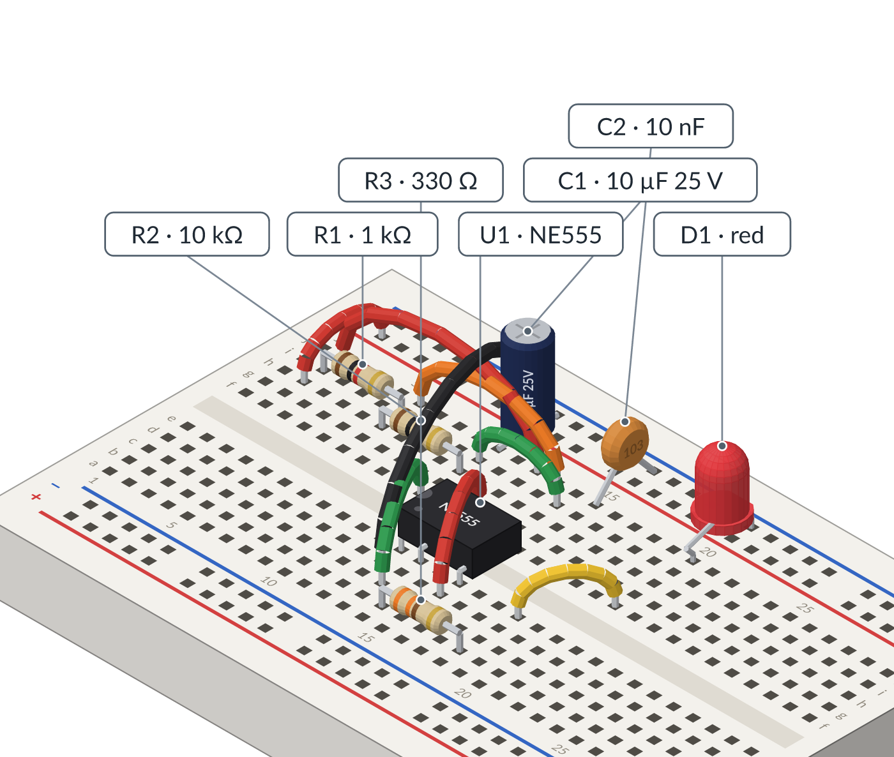

- **Drawn to scale**: resistors with their real colour bands, LEDs, capacitors, transistors,
  regulators, chips, development boards (ESP32, Arduino UNO), batteries. Front and back views.
- **Checked**: from the holes alone the kit knows what is connected, and warns about shorted
  strips, occupied holes, leads that cannot reach and parts that overlap.
- **Simulated** (a model, and labelled as one): voltages, currents, an oscilloscope, LEDs that
  light up, warnings when a part is pushed past its limits, even an Arduino sketch running.
- **Made for assistants**: a skill (`SKILL.md`), an MCP server and three agents, so an AI
  assistant describes the circuit and the kit does the geometry. It never computes a hole by hand.
- **No dependencies**: plain JavaScript, Node ≥ 20 or a browser. English and Spanish.

**Live demo:** [every recipe as a live page](https://ccamilobedoya.github.io/protoboard-iso/)
(tap a part, press *Current*, turn the board around).

## Try it in a minute

```bash
git clone https://github.com/ccamilobedoya/protoboard-iso.git
cd protoboard-iso                      # nothing to install
node bin/protoboard-iso.js layout my-switch --recipe npn-switch --values '{"R1":"470","D1":"green"}'
```

That lays out a transistor switch from a **recipe**, reviews it, and writes `my-switch/`: the
circuit (`circuit.json`), its history, and `out/my-switch.html`, a single page with the drawing and
the live simulation. Open it in a browser. Then:

```bash
node bin/protoboard-iso.js simulate my-switch          # voltages and currents, as text
node bin/protoboard-iso.js render my-switch --view back # the drawing from the other side
node bin/protoboard-iso.js review my-switch             # APPROVED or CHANGES, and why
```

## From a description to a lesson

| 1. Describe | 2. Placed and drawn | 3. Checked |
|---|---|---|
| A circuit file names parts and holes ([format](docs/en/circuit-format.md)), or `layout` places them from a list of connections ([layout](docs/en/layout.md)). | 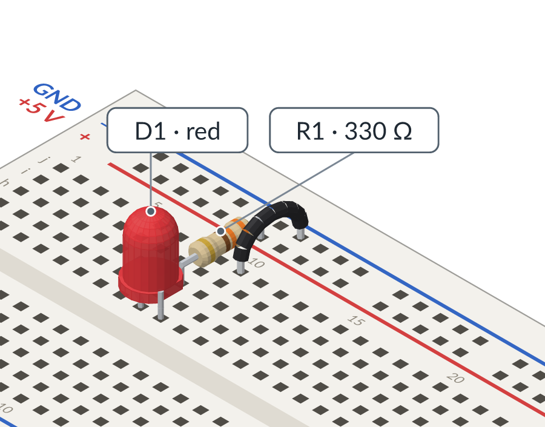 | 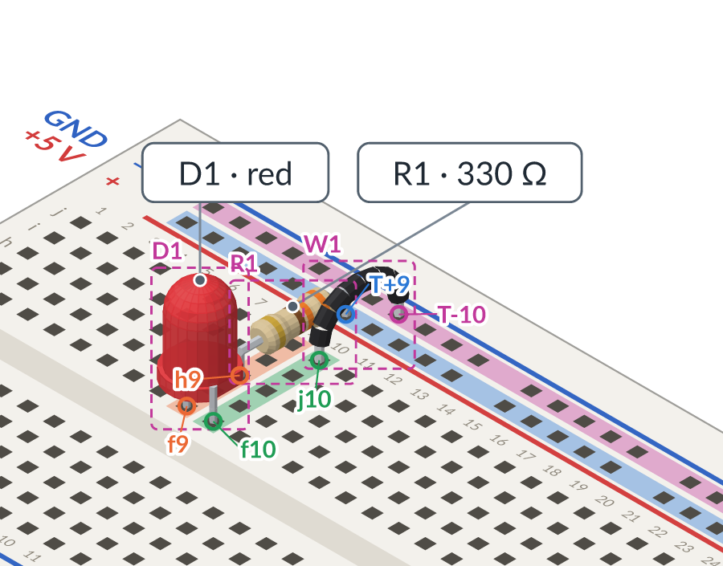 |
| **4. From behind** | **5. Simulated** | **6. Current** |
| 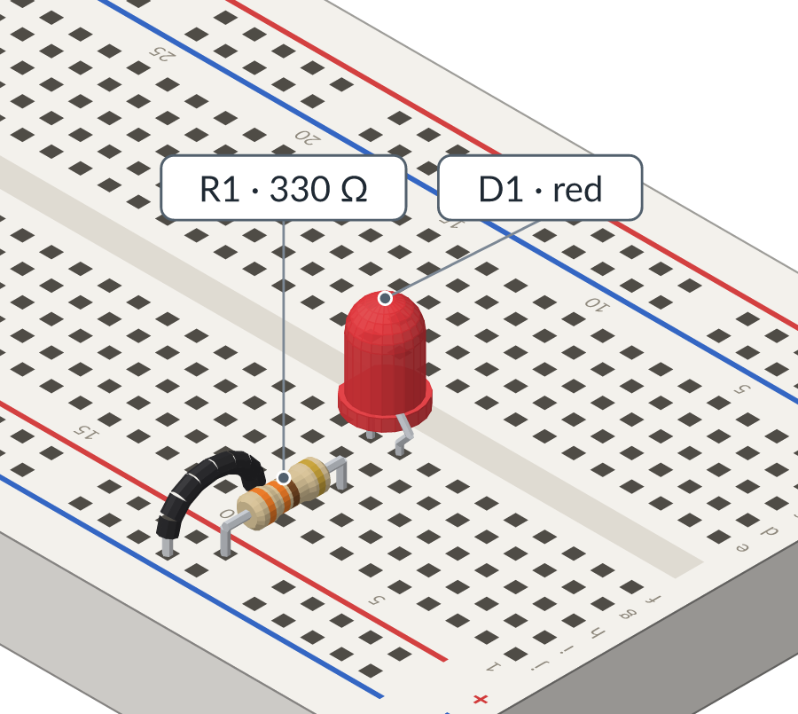 | 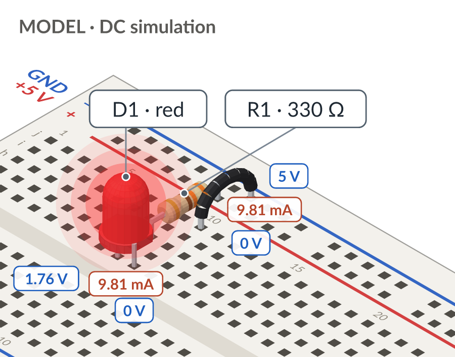 | 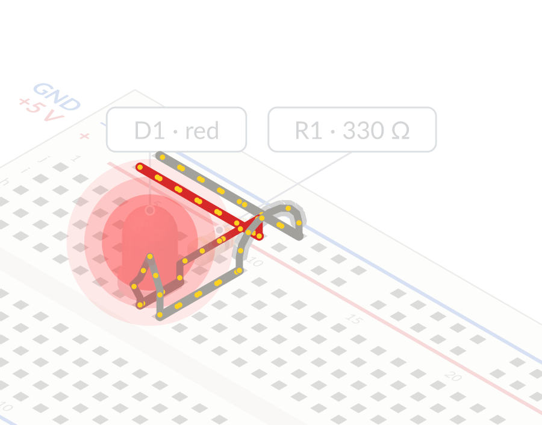 |

The circuit behind those pictures, [`examples/led-resistor.json`](examples/led-resistor.json) (shortened):

```json
{
  "title": { "en": "LED with a current-limiting resistor", "es": "LED con resistencia limitadora" },
  "board": "bb830",
  "netLabels": { "T+": "+5 V", "T-": "GND" },
  "supplies": [{ "id": "V1", "voltage": 5, "currentLimit": 0.1 }],
  "parts": [
    { "id": "R1", "type": "resistor", "value": "330", "pins": ["T+9", "h9"] },
    { "id": "D1", "type": "led", "color": "red", "pins": { "anode": "f9", "cathode": "f10" } },
    { "id": "W1", "type": "wire", "color": "black", "pins": ["j10", "T-10"] }
  ]
}
```

Holes are a row letter and a column (`f9`); rails are `T+`, `T-`, `B+`, `B-` plus a column. Rows
a–e of a column are one node, f–j another, each rail one more: that is all the kit needs to know
what is connected.

**The page.** Every circuit gets `out/<name>.html`, one file with no network and no build, made to
sit in an iframe or a notes app ([embedding](docs/en/embedding.md)). Tap a part and its card shows
its values, an oscilloscope and what each value means; sliders change resistors, supplies and
sensors while it runs.

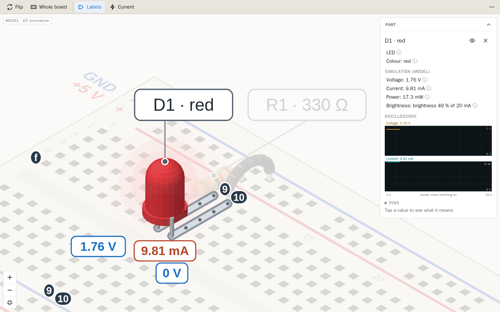

## Recipes

Usual lesson circuits come ready by name, with only the values you change
([all 25 recipes](docs/en/recipes.md)):

| | | |
|---|---|---|
| 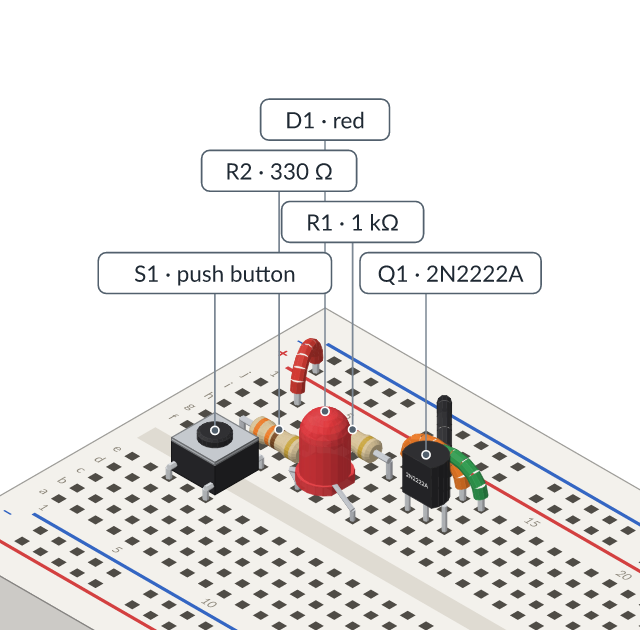<br>`npn-switch`: a button and a transistor switch an LED | 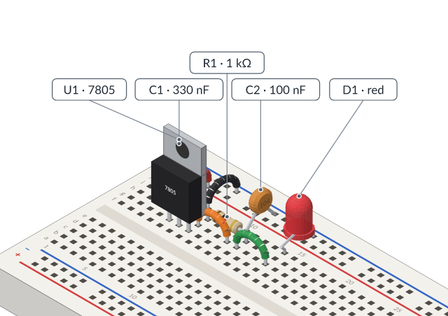<br>`regulator-7805`: a linear regulator and a pilot LED | 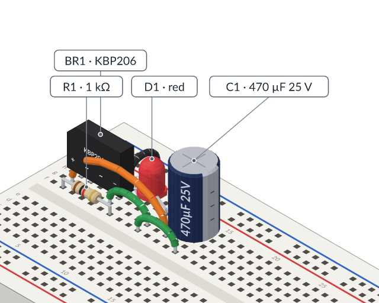<br>`bridge-rectifier`: a bridge, a filter capacitor, a sine in |
| 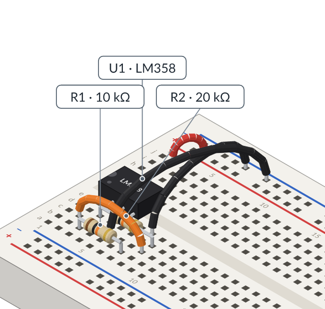<br>`opamp-noninverting`: an LM358 amplifier | 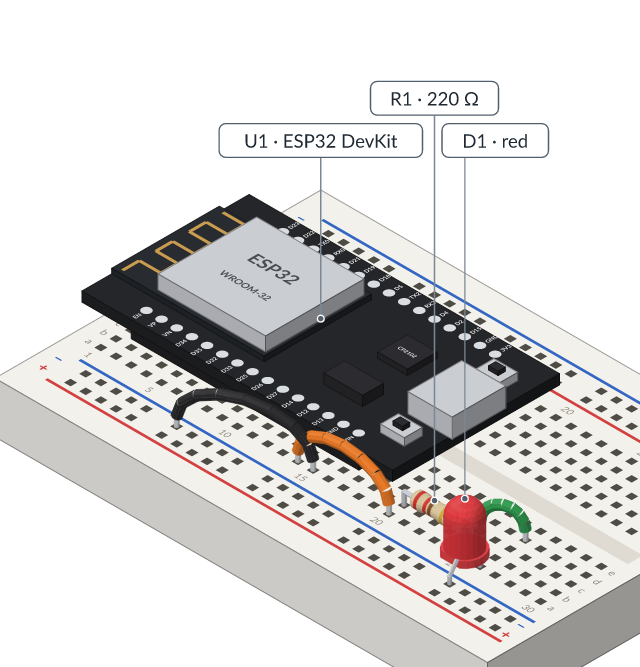<br>`esp32-led`: an ESP32 running a blink sketch | 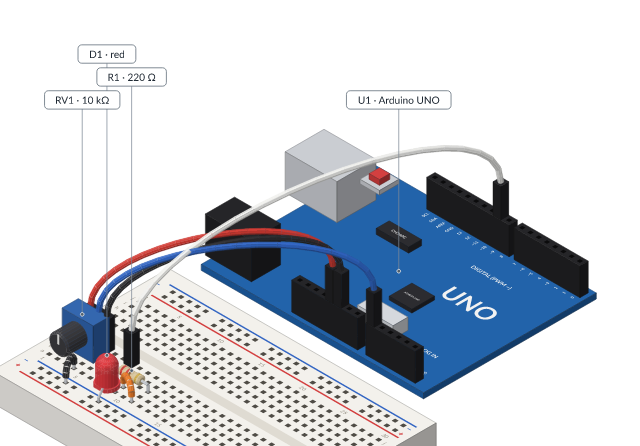<br>`uno-pot-pwm`: an Arduino UNO dims an LED from a potentiometer |

Also: `led-resistor`, `divider`, `potentiometer-led`, `mosfet-switch`, `button-pullup`,
`button-pulldown`, `rc-square`, `555-astable`, `regulator-ams1117`, `zener-regulator`,
`esp32-button`, `opamp-comparator`, `lm393-comparator`, `opamp-follower`, `opamp-inverting`,
`uno-blink`, `uno-button`, `c3-blink`, `c3-pot-pwm`.

More circuit files, each with what it shows: [examples/](examples/README.md).

## Three ways to use it

**Command line.** `node bin/protoboard-iso.js <command>`: `layout`, `check`, `render`,
`inspect`, `simulate`, `page`, `review`, `query`, `suggest`, `apply`, `undo`, `history`. Run it
with no arguments for the full list. [Agent interface](docs/en/agent-interface.md) explains how a
circuit is changed with operations instead of being rewritten.

**MCP server** (Claude Code, Claude Desktop and other MCP clients). In this repository,
`.mcp.json` already registers it; elsewhere:

```bash
cd mcp && npm install && cd ..
claude mcp add protoboard-iso -e PROTOBOARD_ROOT="$PWD" -- node "$PWD/mcp/server.js"
```

Then ask for a circuit in plain words ("an LED with its resistor on 9 V"). Setup and the tools:
[docs/en/mcp.md](docs/en/mcp.md).

**Agent skill.** `SKILL.md` tells an assistant how to use the kit. Link this folder into your
skills directory, for example `ln -s "$PWD" ~/.claude/skills/protoboard-iso`. For circuit work the
repository also has three agents in `.claude/agents/` (one lays out, one reviews, one adds parts):
[agents](docs/en/agents.md).

**As a library**, in Node or a browser:

```js
import { renderCircuit } from './src/index.js';
const { svg, issues } = renderCircuit(circuit, { view: 'front', lang: 'en' });
```

## What it is and is not

- The simulation is a **model**, not a measurement: every result says so. It is good for seeing
  why an LED needs a resistor or how a capacitor charges; it is not a replacement for SPICE.
  Its results are compared with [Falstad's simulator](docs/en/falstad.md) case by case.
- The catalog covers a usual beginner's kit and a bit more
  ([circuit format](docs/en/circuit-format.md)); new parts follow
  [adding parts](docs/en/adding-parts.md).
- Messages, labels and pages come out in **English or Spanish** (`--lang es`, or `"lang": "es"` in
  the circuit). JSON keys stay in English so circuits are shared across languages.

## Documentation

**Using the kit**

| | English | Español |
|---|---|---|
| Circuit file format | [circuit-format.md](docs/en/circuit-format.md) | [formato-circuito.md](docs/es/formato-circuito.md) |
| Recipes: lesson circuits by name | [recipes.md](docs/en/recipes.md) | [recetas.md](docs/es/recetas.md) |
| Layout: placing a whole circuit | [layout.md](docs/en/layout.md) | [montaje-automatico.md](docs/es/montaje-automatico.md) |
| Simulation (a model) | [simulation.md](docs/en/simulation.md) | [simulacion.md](docs/es/simulacion.md) |
| Microcontrollers (ESP32, UNO) and their sketches | [microcontrollers.md](docs/en/microcontrollers.md) | [microcontroladores.md](docs/es/microcontroladores.md) |
| Focus and the current layer | [focus-and-flow.md](docs/en/focus-and-flow.md) | [foco-y-corriente.md](docs/es/foco-y-corriente.md) |
| Embedding a circuit in documentation | [embedding.md](docs/en/embedding.md) | [embeber.md](docs/es/embeber.md) |
| Falstad: open a circuit in CircuitJS | [falstad.md](docs/en/falstad.md) | [falstad.md](docs/es/falstad.md) |
| Inspecting and annotating | [inspect-and-annotate.md](docs/en/inspect-and-annotate.md) | [inspeccionar-y-anotar.md](docs/es/inspeccionar-y-anotar.md) |
| Agent interface (resume, change, undo) | [agent-interface.md](docs/en/agent-interface.md) | [interfaz-para-agentes.md](docs/es/interfaz-para-agentes.md) |
| MCP server | [mcp.md](docs/en/mcp.md) | [mcp.md](docs/es/mcp.md) |
| Agents (layout, reviewer, parts librarian) | [agents.md](docs/en/agents.md) | [agentes.md](docs/es/agentes.md) |

**Working on the kit**

| | English | Español |
|---|---|---|
| Code map (start here) | [code-map.md](docs/en/code-map.md) | [mapa-del-codigo.md](docs/es/mapa-del-codigo.md) |
| How it is built | [architecture.md](docs/en/architecture.md) | [arquitectura.md](docs/es/arquitectura.md) |
| Adding a part or a board | [adding-parts.md](docs/en/adding-parts.md) | [agregar-componentes.md](docs/es/agregar-componentes.md) |
| Translating | [translating.md](docs/en/translating.md) | [traducir.md](docs/es/traducir.md) |
| Roadmap | [ROADMAP.md](ROADMAP.md) | [hoja-de-ruta.md](docs/es/hoja-de-ruta.md) |
| Planning and decision log | [PLANNING.md](PLANNING.md) | [planeacion.md](docs/es/planeacion.md) |
| Development notes: live simulation, user-experience pass | [live-simulation.md](docs/en/live-simulation.md), [ux-pass.md](docs/en/ux-pass.md) | [simulacion-en-vivo.md](docs/es/simulacion-en-vivo.md), [experiencia-de-uso.md](docs/es/experiencia-de-uso.md) |

## Contributing

Issues and pull requests are welcome, especially new parts (with their datasheet) and
translations. Before a pull request: `npm test` passes, `npm run examples` shows no new problems,
and the Spanish documentation follows the English. `CLAUDE.md` has the rules of the repository;
one of them: no personal data, private paths or private hostnames in anything committed.

The pictures in this README are drawn by the kit: `npm install` (development only), then
`node scripts/readme-images.js`.

## Credits

Inspired by [Anatomy](https://github.com/wheresryan22/anatomy) (isometric machines) and by the
[Falstad circuit simulator](https://www.falstad.com/circuit/) (seeing current flow). Part
dimensions come from their manufacturers' datasheets.

## License

MIT. See [LICENSE](LICENSE).
