<p align="center"></p>
<h1 align="center">Protoboard ISO</h1>
<p align="center"><strong>Breadboard circuits you can build, break and understand, from a sentence.</strong><br>Ask for a circuit. See it built on a breadboard, hole by hole, and running.</p>
<p align="center"><a href="https://ccamilobedoya.github.io/protoboard-iso/">Live demo</a> · <a href="README.es.md">Español</a> · <a href="docs/en/README.md">Docs</a> · <a href="LICENSE">MIT licence</a></p>
<p align="center"><a href="https://github.com/ccamilobedoya/protoboard-iso/actions/workflows/ci.yml"></a> <a href="CHANGELOG.md"></a> <a href="LICENSE"></a> <a href="https://nodejs.org/"></a></p>


## Quick start

Pick one. Each takes about a minute.

### 1. See it running

[**Open the live demo**](https://ccamilobedoya.github.io/protoboard-iso/) in your browser. Nothing to install.

### 2. Ask Claude for a circuit

No terminal. In the Claude app:

1. Open **Customize → Plugins → Add → Add marketplace**.
2. Paste `https://github.com/ccamilobedoya/protoboard-iso` and install **Protoboard ISO**.
3. Ask in your own words: *a red LED with its resistor on 9 V*.

Code execution must be on in the app. To see the board inside the chat in Claude Desktop,
[add the extension](docs/en/mcp.md#claude-desktop-with-one-click).

### 3. Run it on your computer

Needs [Node.js](https://nodejs.org/) 22 or newer, and nothing else.

<!-- smoke -->
```bash
git clone https://github.com/ccamilobedoya/protoboard-iso.git
cd protoboard-iso                      # nothing to install
node bin/protoboard-iso.js layout my-led --recipe led-resistor --values '{"R1":"470","D1":"green"}'
```

Open the page it prints (`Page: …`) in a browser. More commands, and Windows PowerShell:
[for developers](#for-developers).

## What you can ask

- "a red LED with its resistor on 9 V"
- "make the resistor 1k"
- "a red LED on 9 V with 15 mA through the LED"
- "an Arduino UNO blinking an LED, with its sketch"
- "what is this part, and which leg is which?"
- "fix it", after a warning

The kit does what you ask even when it is a bad idea, and tells you what would burn and how to fix
it: that is how one learns.

## What you get

| | | |
|---|---|---|
| 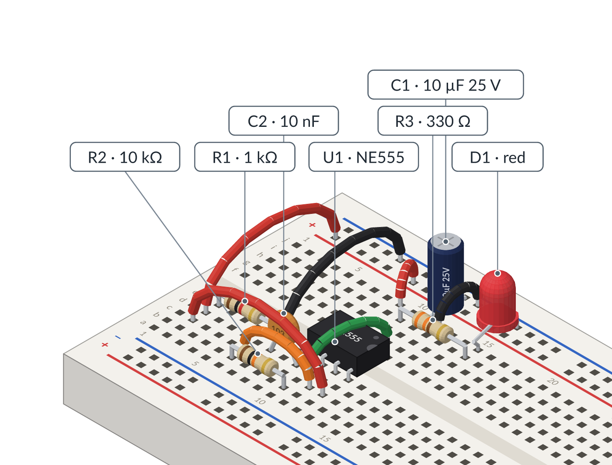<br>**On the breadboard.** Every part in real holes, at its real size, with its jumpers: copy it onto yours. | 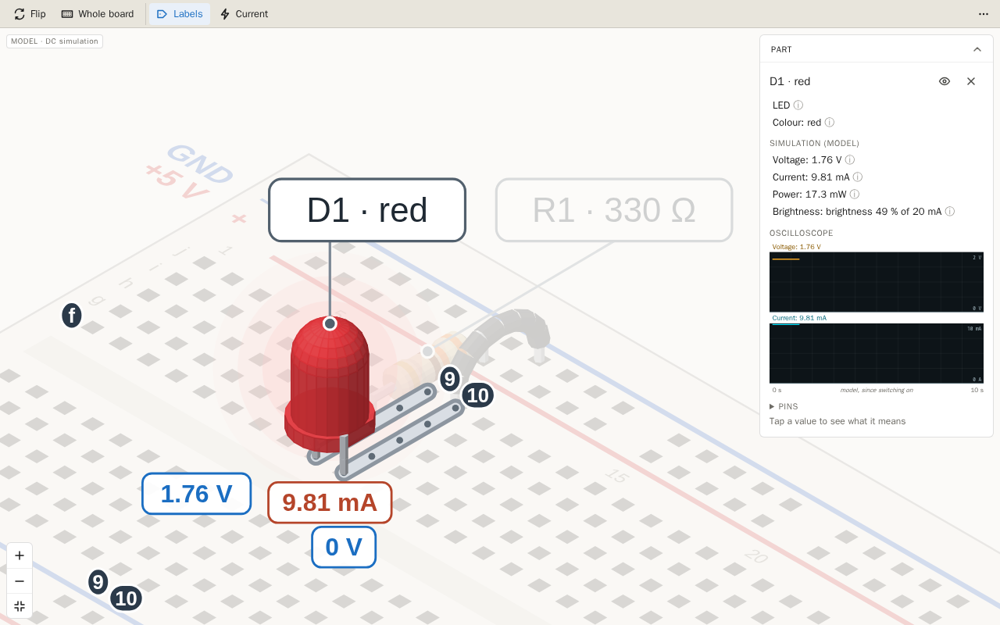<br>**Running.** One page with the simulation: tap a part for its voltage, current and oscilloscope. | 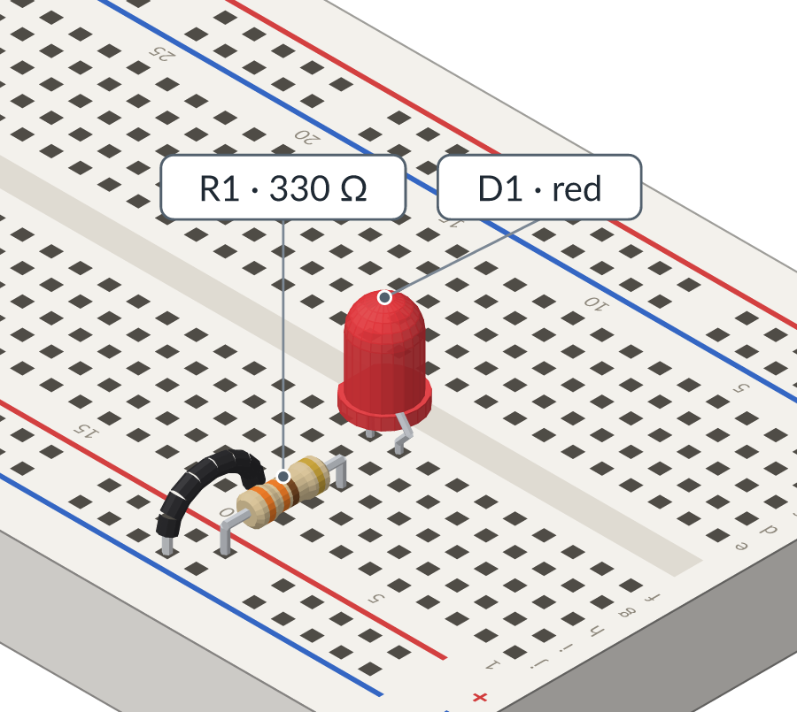<br>**From the other side.** The board turned around, labelled, so nothing hides behind a part. |

And an honest answer. An Arduino driving a buzzer directly from a pin
([the circuit](test/fixtures/kit-first/buzzer-on-pin.json)), as `layout` reports it:

```text
Review (lesson): APPROVED WITH WARNINGS.
As wired, this would damage:
  ⚠ warning: U1.D10 carries 88.3 mA, more than its maximum 40 mA: the pin can be damaged, with D9 + D10 high.
To fix it: a 200 Ω resistor in series with BZ1 brings U1's D10 to 19.4 mA (maximum 40 mA).
```

## Recipes

Usual lesson circuits come ready by name, with only the values you change
([all the recipes](docs/en/recipes.md)):

| | | |
|---|---|---|
| 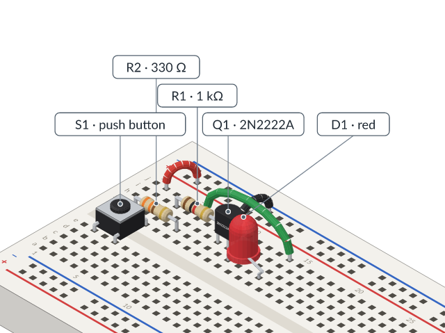<br>`npn-switch`: a button and a transistor switch an LED | 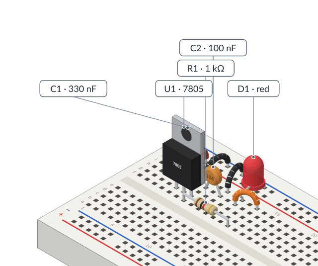<br>`regulator-7805`: a linear regulator and a pilot LED | 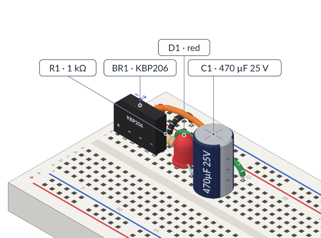<br>`bridge-rectifier`: a bridge, a filter capacitor, a sine in |
| 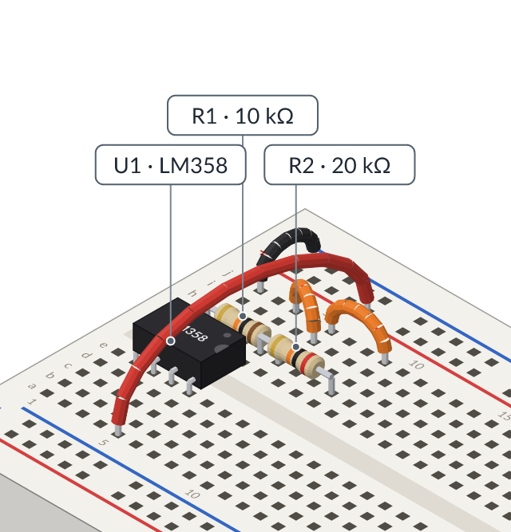<br>`opamp-noninverting`: an LM358 amplifier | 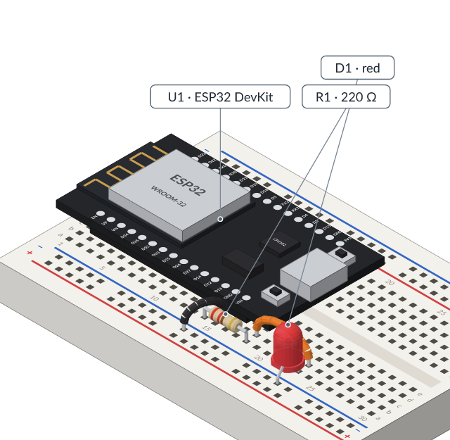<br>`esp32-led`: an ESP32 running a blink sketch | 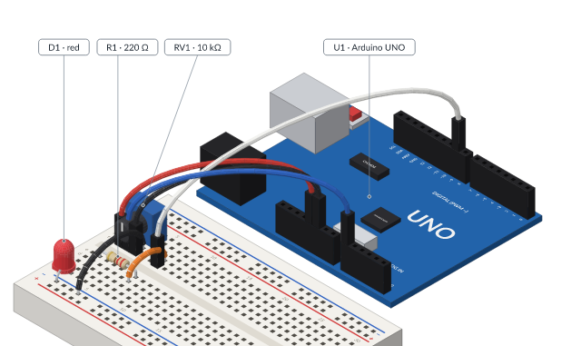<br>`uno-pot-pwm`: an Arduino UNO dims an LED from a potentiometer |

Also: `led-resistor`, `divider`, `potentiometer-led`, `mosfet-switch`, `button-pullup`,
`button-pulldown`, `rc-square`, `555-astable`, `regulator-ams1117`, `zener-regulator`,
`esp32-button`, `opamp-comparator`, `lm393-comparator`, `opamp-follower`, `opamp-inverting`,
`uno-blink`, `uno-button`, `c3-blink`, `c3-pot-pwm`.

More circuit files, each with what it shows: [examples/](examples/README.md).

## How it works

From a description to a lesson, in six steps:

| 1. Describe | 2. Placed and drawn | 3. Checked |
|---|---|---|
| A circuit file names parts and holes ([format](docs/en/circuit-format.md)), or `layout` places them from a list of connections ([layout](docs/en/layout.md)). | 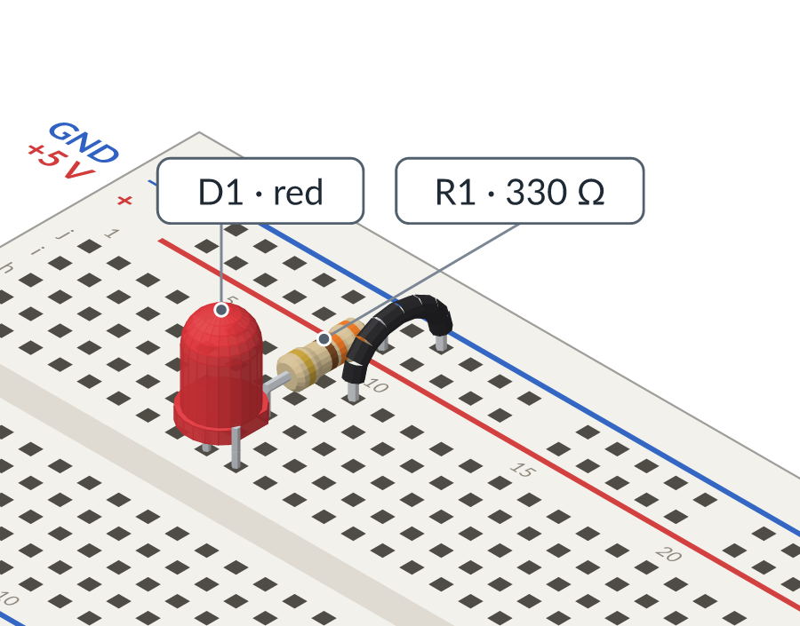 | 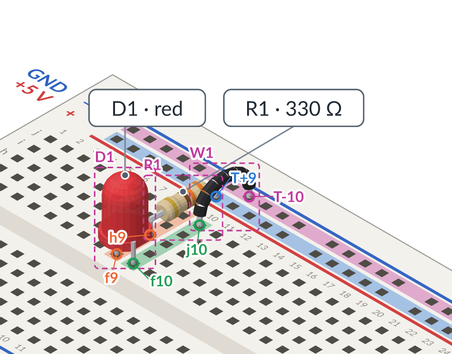 |
| **4. From behind** | **5. Simulated** | **6. Current** |
|  | 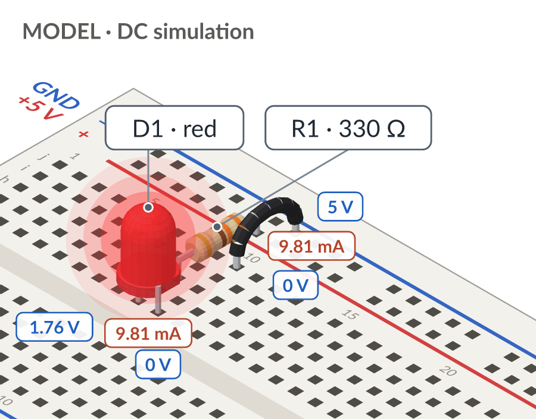 | 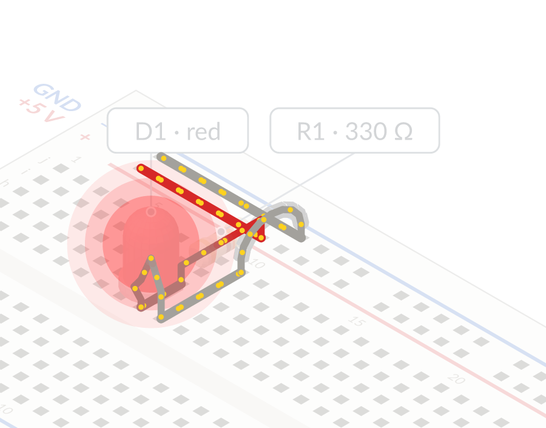 |

The circuit behind those pictures, [`examples/led-resistor.json`](examples/led-resistor.json) (shortened):

```json
{
  "title": { "en": "LED with a current-limiting resistor", "es": "LED con resistencia limitadora" },
  "board": "bb830",
  "netLabels": { "T+": "+5 V", "T-": "GND" },
  "supplies": [{ "id": "V1", "voltage": 5, "currentLimit": 0.1 }],
  "parts": [
    { "id": "R1", "type": "resistor", "value": "330", "pins": ["T+9", "h9"] },
    { "id": "D1", "type": "led", "color": "red", "pins": { "anode": "f9", "cathode": "f10" } },
    { "id": "W1", "type": "wire", "color": "black", "pins": ["j10", "T-10"] }
  ]
}
```

Holes are a row letter and a column (`f9`); rails are `T+`, `T-`, `B+`, `B-` plus a column. Rows
a–e of a column are one node, f–j another, each rail one more: that is all the kit needs to know
what is connected.

**The page.** Every circuit gets `out/<name>.html`, one file with no network and no build, made to
sit in an iframe or a notes app ([embedding](docs/en/embedding.md)). Tap a part and its card shows
its values, an oscilloscope and what each value means; sliders change resistors, supplies and
sensors while it runs.

## For developers

<details>
<summary><strong>The command line</strong></summary>

`node bin/protoboard-iso.js <command>`: `layout`, `check`, `render`, `inspect`, `simulate`, `page`,
`review`, `query`, `suggest`, `apply`, `undo`, `history`. Run it with no arguments for the full
list. After the circuit of the [quick start](#quick-start), `my-led/` also holds the circuit
(`circuit.json`) and its history. Then:

<!-- smoke -->
```bash
node bin/protoboard-iso.js simulate my-led          # voltages and currents, as text
node bin/protoboard-iso.js render my-led --view back # the drawing from the other side
node bin/protoboard-iso.js review my-led             # APPROVED or CHANGES, and why
```

The quotes of `--values` do not reach the program the same way in Windows PowerShell 5.1 (it
strips the inner double quotes). Pass the same values through standard input instead, which works
in every shell:

```powershell
'{"recipe":"led-resistor","values":{"R1":"470","D1":"green"}}' | node bin/protoboard-iso.js layout my-led -
```

[Agent interface](docs/en/agent-interface.md) explains how a circuit is changed with operations
instead of being rewritten.

</details>

<details>
<summary><strong>The MCP server</strong> (Claude Code, Claude Desktop and other MCP clients)</summary>

In this repository, `.mcp.json` already registers it; elsewhere:

```bash
cd mcp && npm install && cd ..
mkdir -p "$HOME/circuits"              # where your circuits are saved: a folder of your own, not this clone
claude mcp add protoboard-iso -e PROTOBOARD_ROOT="$HOME/circuits" -- node "$PWD/mcp/server.js"
```

Then ask for a circuit in plain words ("an LED with its resistor on 9 V"). Setup, the tools and
the Claude Desktop configuration (Windows paths included): [docs/en/mcp.md](docs/en/mcp.md).

</details>

<details>
<summary><strong>The plugin and the desktop extension</strong>, in detail</summary>

**Plugin with the skill** (the Claude apps and Claude Code). The plugin in
[plugin/](plugin/README.md) holds one skill with the kit inside: it runs where the assistant runs
code, with Node ≥ 22 and nothing to install. In the Claude app, add the marketplace by this
repository's URL (`https://github.com/ccamilobedoya/protoboard-iso`) and install
`protoboard-iso`; in Claude Code, `/plugin marketplace add ccamilobedoya/protoboard-iso`, then
`/plugin install protoboard-iso@protoboard-iso`.

**Desktop extension** (Claude Desktop; optional, no terminal). The plugin works by itself; the
extension adds the live board inside the conversation, where you tap a part or move a slider. It
is the MCP server in one file (`.mcpb`, an MCP Bundle) with everything it needs. From the first
published release on, download `protoboard-iso-<version>.mcpb` from the
[releases](https://github.com/ccamilobedoya/protoboard-iso/releases), double-click it, choose
the folder for your circuits, switch the extension on in its settings (it installs switched off)
and ask for a circuit. The install warning about access to the computer is the app's, shown for
every local extension. Details: [Claude Desktop with one click](docs/en/mcp.md#claude-desktop-with-one-click).

</details>

<details>
<summary><strong>As a library</strong>, in Node or a browser</summary>

```js
import { renderCircuit } from './src/index.js';
const { svg, issues } = renderCircuit(circuit, { view: 'front', lang: 'en' });
```

</details>

<details>
<summary><strong>Agents</strong> for circuit work</summary>

The repository has three agents in `.claude/agents/`: one lays out, one reviews, one adds parts.
How to run them and their brief formats: [agents](docs/en/agents.md).

</details>

## What it is and is not

- **Drawn to scale**: resistors with their real colour bands, LEDs, capacitors, transistors,
  regulators, chips, development boards (ESP32, Arduino UNO), batteries. Front and back views.
- **Checked**: from the holes alone the kit knows what is connected, and warns about shorted
  strips, occupied holes, leads that cannot reach and parts that overlap.
- **Simulated** (a model, and labelled as one): voltages, currents, an oscilloscope, LEDs that
  light up, warnings when a part is pushed past its limits, even an Arduino sketch running.
- **Made for assistants**: a plugin with one skill (the kit inside), an MCP server and three
  agents, so an AI assistant describes the circuit and the kit does the geometry. It never
  computes a hole by hand.
- **No dependencies**: plain JavaScript, Node ≥ 22 or a browser. English and Spanish.
- **In use**: [ohmio.dev](https://ohmio.dev/) teaches electronics with circuits drawn and
  simulated by this kit.

And what it is not:

- The simulation is a **model**, not a measurement: every result says so. It is good for seeing
  why an LED needs a resistor or how a capacitor charges; it is not a replacement for SPICE.
  Its results are compared with [Falstad's simulator](docs/en/falstad.md) case by case.
- The catalog covers a usual beginner's kit and a bit more
  ([circuit format](docs/en/circuit-format.md)); new parts follow
  [adding parts](docs/en/adding-parts.md).
- Messages, labels and pages come out in **English or Spanish** (`--lang es`, or `"lang": "es"` in
  the circuit). JSON keys stay in English so circuits are shared across languages.

## Documentation

Every document with what it is for: [docs/en/README.md](docs/en/README.md).

**Using the kit**

| | English | Español |
|---|---|---|
| Circuit file format | [circuit-format.md](docs/en/circuit-format.md) | [formato-circuito.md](docs/es/formato-circuito.md) |
| Recipes: lesson circuits by name | [recipes.md](docs/en/recipes.md) | [recetas.md](docs/es/recetas.md) |
| Layout: placing a whole circuit | [layout.md](docs/en/layout.md) | [montaje-automatico.md](docs/es/montaje-automatico.md) |
| Simulation (a model) | [simulation.md](docs/en/simulation.md) | [simulacion.md](docs/es/simulacion.md) |
| Microcontrollers (ESP32, UNO) and their sketches | [microcontrollers.md](docs/en/microcontrollers.md) | [microcontroladores.md](docs/es/microcontroladores.md) |
| Focus and the current layer | [focus-and-flow.md](docs/en/focus-and-flow.md) | [foco-y-corriente.md](docs/es/foco-y-corriente.md) |
| Embedding a circuit in documentation | [embedding.md](docs/en/embedding.md) | [embeber.md](docs/es/embeber.md) |
| Falstad: open a circuit in CircuitJS | [falstad.md](docs/en/falstad.md) | [falstad.md](docs/es/falstad.md) |
| Inspecting and annotating | [inspect-and-annotate.md](docs/en/inspect-and-annotate.md) | [inspeccionar-y-anotar.md](docs/es/inspeccionar-y-anotar.md) |
| Agent interface (resume, change, undo) | [agent-interface.md](docs/en/agent-interface.md) | [interfaz-para-agentes.md](docs/es/interfaz-para-agentes.md) |
| MCP server | [mcp.md](docs/en/mcp.md) | [mcp.md](docs/es/mcp.md) |
| Agents (layout, reviewer, parts librarian) | [agents.md](docs/en/agents.md) | [agentes.md](docs/es/agentes.md) |

**Working on the kit**

| | English | Español |
|---|---|---|
| Code map (start here) | [code-map.md](docs/en/code-map.md) | [mapa-del-codigo.md](docs/es/mapa-del-codigo.md) |
| How it is built | [architecture.md](docs/en/architecture.md) | [arquitectura.md](docs/es/arquitectura.md) |
| Adding a part or a board | [adding-parts.md](docs/en/adding-parts.md) | [agregar-componentes.md](docs/es/agregar-componentes.md) |
| Translating | [translating.md](docs/en/translating.md) | [traducir.md](docs/es/traducir.md) |
| Roadmap | [ROADMAP.md](ROADMAP.md) | [hoja-de-ruta.md](docs/es/hoja-de-ruta.md) |
| Planning and decision log | [PLANNING.md](PLANNING.md) | [planeacion.md](docs/es/planeacion.md) |
| Development notes: live simulation, user-experience pass | [live-simulation.md](docs/en/live-simulation.md), [ux-pass.md](docs/en/ux-pass.md) | [simulacion-en-vivo.md](docs/es/simulacion-en-vivo.md), [experiencia-de-uso.md](docs/es/experiencia-de-uso.md) |

## Contributing

Issues and pull requests are welcome, especially new parts (with their datasheet) and
translations. Before a pull request: `npm test` passes, `npm run examples` shows no new problems,
and the Spanish documentation follows the English. `CLAUDE.md` has the rules of the repository;
one of them: no personal data, private paths or private hostnames in anything committed.

The pictures in this README are drawn by the kit: `npm install` (development only), then
`node scripts/readme-images.js`. The animation is recorded by the kit too: `npm run readme-gif`
(it also needs ffmpeg).

## Credits

Inspired by [Anatomy](https://github.com/wheresryan22/anatomy) (isometric machines) and by the
[Falstad circuit simulator](https://www.falstad.com/circuit/) (seeing current flow). Part
dimensions come from their manufacturers' datasheets.

## License

MIT. See [LICENSE](LICENSE).
