# Examples

*[Español](README.es.md)*

Circuit files to read, copy and change. The ones with a source (a supply, a battery or a board on
USB) also run in the [live demo](https://ccamilobedoya.github.io/protoboard-iso/).

```bash
node bin/protoboard-iso.js check examples/led-resistor.json        # what is connected, and any problem
node bin/protoboard-iso.js render examples/led-resistor.json -o led.svg --fit parts
node bin/protoboard-iso.js page examples/led-resistor.json -o led.html   # the live page
npm run examples                                                   # every example → examples/out/ (index.html)
```

## Three ways to describe a circuit

| How | When | Example |
|---|---|---|
| **By hand**: every part with its holes (`pins`) | You want each hole exactly where it is on your board | [`led-resistor.json`](led-resistor.json) |
| **Layout**: parts without holes and the nets that join them; `layout` places and wires them | Another new circuit | [`layout/regulator-led.json`](layout/regulator-led.json): `node bin/protoboard-iso.js layout my-regulator examples/layout/regulator-led.json` |
| **Recipe**: a usual lesson circuit by name, only the values that change | The circuit is one of the [25 recipes](../docs/en/recipes.md) | `node bin/protoboard-iso.js layout my-divider --recipe divider --values '{"R2":"4k7"}'` |

The format of each field: [circuit-format.md](../docs/en/circuit-format.md).

## First steps

| | |
|---|---|
| 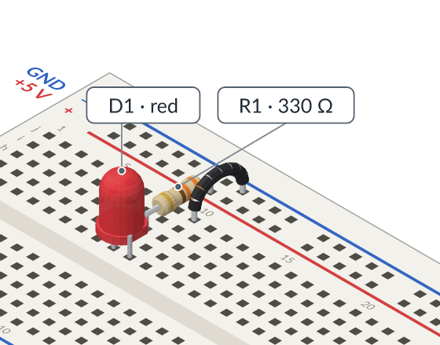 | **[led-resistor.json](led-resistor.json)**: an LED with its current-limiting resistor on 5 V. The smallest circuit with a simulation; the README's pictures are drawn from it. |
| 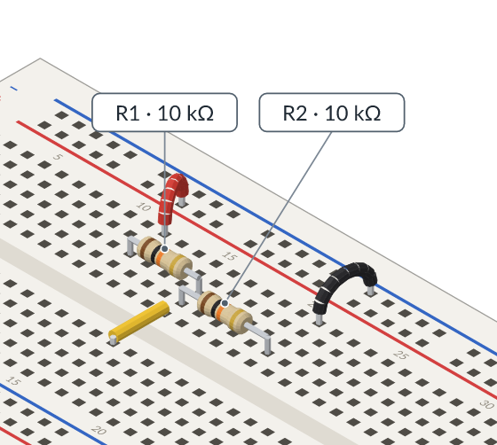 | **[voltage-divider.json](voltage-divider.json)**: two 10 kΩ resistors split 9 V in half; the page shows the voltage where they meet. |
| 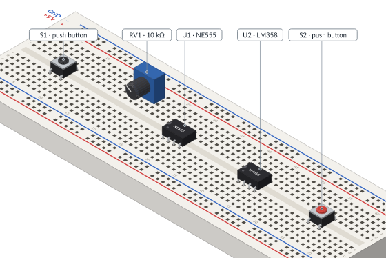 | **[controls-and-ics.json](controls-and-ics.json)**: push buttons across the centre channel, potentiometers and DIP chips (NE555, LM358) placed by their pin 1. Drawing only, no source. |

## Power

| | |
|---|---|
| 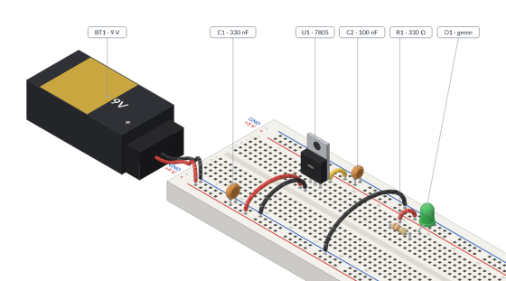 | **[battery-regulator.json](battery-regulator.json)**: a 9 V battery beside the board, a 7805 regulator with its capacitors and an LED. Batteries: chemistry, cells in series, state of charge. |
| 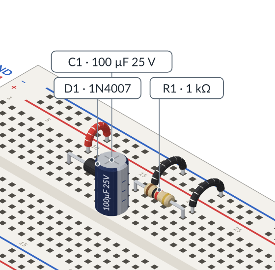 | **[half-wave-rectifier.json](half-wave-rectifier.json)**: one diode and a filter capacitor fed by a 50 Hz signal generator; the oscilloscope shows the ripple. |
| 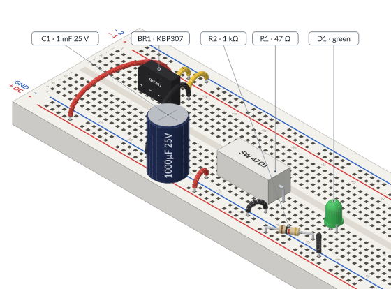 | **[rectifier.json](rectifier.json)**: a bridge rectifier, a filter capacitor, a 5 W cement resistor as the load and an LED. |
| 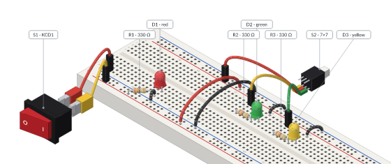 | **[switches.json](switches.json)**: a rocker switch on alligator clips and a latching switch, off the board; *On/Off* in the page. |
| 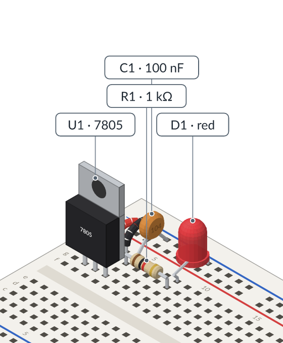 | **[layout/regulator-led.json](layout/regulator-led.json)**: a layout spec (parts and nets only): a 7805 and a pilot LED. |
| 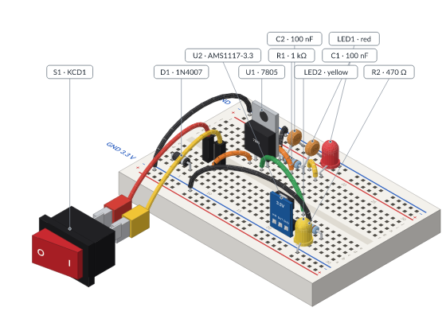 | **[layout/two-rail-supply.json](layout/two-rail-supply.json)**: a layout spec: 12 V through a protection diode and a power switch, a 7805 to 5 V, then an AMS1117 to 3.3 V, each with a pilot LED. |

## Signals in time

| | |
|---|---|
| 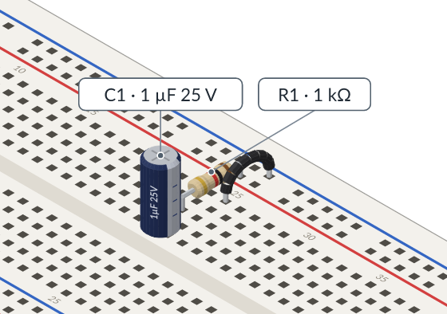 | **[rc-square-wave.json](rc-square-wave.json)**: a resistor and a capacitor charged by a square wave; compare the time constant with the period on the oscilloscope. |

## Microcontrollers

| | |
|---|---|
| 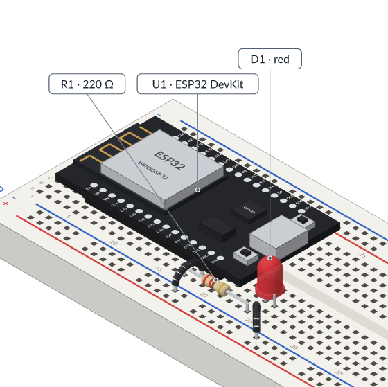 | **[esp32-led.json](esp32-led.json)**: an ESP32 DevKit over the centre channel lights an LED from D13 (the pin's state set in `io`). On USB it is the source. |
| 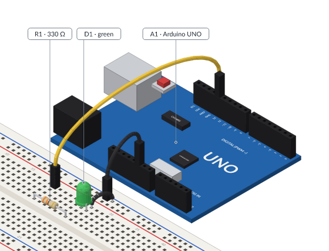 | **[uno-led.json](uno-led.json)**: an Arduino UNO beside the board, Dupont leads to an LED on D13. |
| 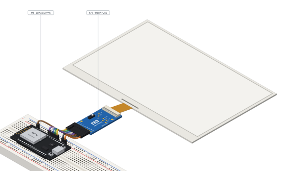 | **[epaper-esp32.json](epaper-esp32.json)**: an ESP32 driving a 7.5" e-paper panel through the DESPI-C02 adapter. |

Programs (Arduino sketches that run in the simulation) are in the microcontroller recipes:
[microcontrollers.md](../docs/en/microcontrollers.md).

## The catalog

| | |
|---|---|
| 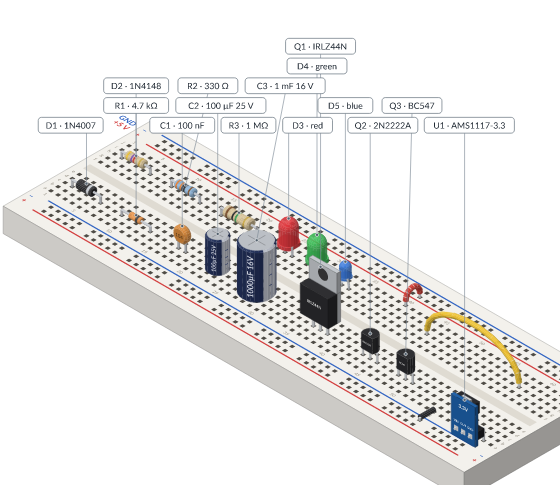 | **[parts-showcase.json](parts-showcase.json)**: resistors (5 % and 1 %), diodes, LEDs, capacitors, transistors, an AMS1117 module and jumpers side by side. Its notes about unconnected pins are expected. |
| 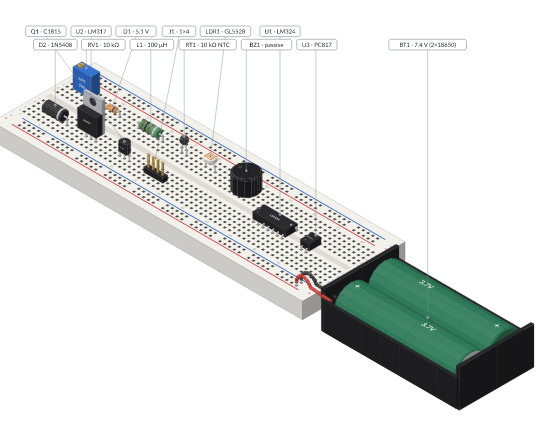 | **[more-parts.json](more-parts.json)**: trimmer, Zener, inductor, thermistor, LDR, buzzer, header, LM324, LM317, PC817 and lithium cells. |

## Wrong on purpose

| | |
|---|---|
| 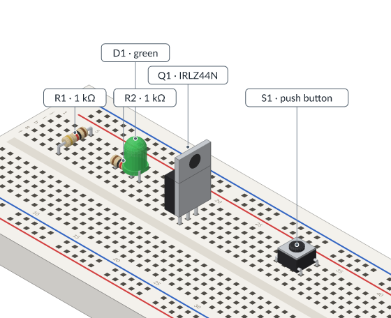 | **[common-mistakes.json](common-mistakes.json)**: **this circuit is wrong on purpose.** Each part makes a usual mistake, and `check` reports every one: two leads in one hole, a resistor shorted along one strip, a transistor with its three pins in one strip, a button that is always closed, leads too close for the body. Run `node bin/protoboard-iso.js check examples/common-mistakes.json` and compare. |

## Adding an example

A new example is a circuit file here that `check` passes (unless it shows mistakes on purpose)
with a `title` in English and Spanish. Then `node scripts/readme-images.js examples/` draws its
thumbnail, and it gets a row in this file and in [README.es.md](README.es.md).
