# Examples

*[Español](README.es.md)*

Circuit files to read, copy and change. The ones with a source (a supply, a battery or a board on
USB) also run in the [live demo](https://ccamilobedoya.github.io/protoboard-iso/).

```bash
node bin/protoboard-iso.js check examples/led-resistor.json        # what is connected, and any problem
node bin/protoboard-iso.js render examples/led-resistor.json -o led.svg --fit parts
node bin/protoboard-iso.js page examples/led-resistor.json -o led.html   # the live page
npm run examples                                                   # every example → examples/out/ (index.html)
```

## Three ways to describe a circuit

| How | When | Example |
|---|---|---|
| **By hand**: every part with its holes (`pins`) | You want each hole exactly where it is on your board | [`led-resistor.json`](led-resistor.json) |
| **Layout**: parts without holes and the nets that join them; `layout` places and wires them | Another new circuit | [`layout/regulator-led.json`](layout/regulator-led.json): `node bin/protoboard-iso.js layout my-regulator examples/layout/regulator-led.json` |
| **Recipe**: a usual lesson circuit by name, only the values that change | The circuit is one of the [37 recipes](../docs/en/recipes.md) | `node bin/protoboard-iso.js layout my-divider --recipe divider --values '{"R2":"4k7"}'` |

The format of each field: [circuit-format.md](../docs/en/circuit-format.md).

## First steps

| | |
|---|---|
| 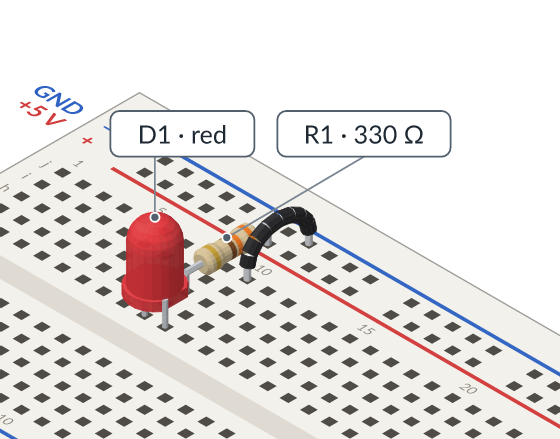 | **[led-resistor.json](led-resistor.json)**: an LED with its current-limiting resistor on 5 V. The smallest circuit with a simulation; the README's pictures are drawn from it. |
| 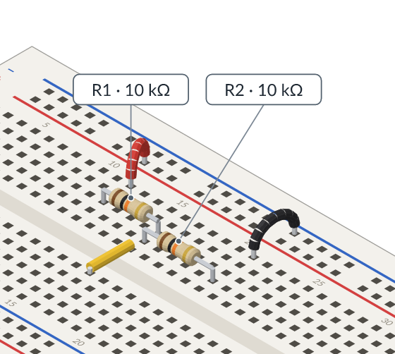 | **[voltage-divider.json](voltage-divider.json)**: two 10 kΩ resistors split 9 V in half; the page shows the voltage where they meet. |
| 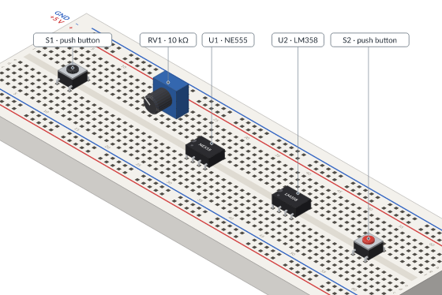 | **[controls-and-ics.json](controls-and-ics.json)**: push buttons across the centre channel, potentiometers and DIP chips (NE555, LM358) placed by their pin 1. Drawing only, no source. |
| 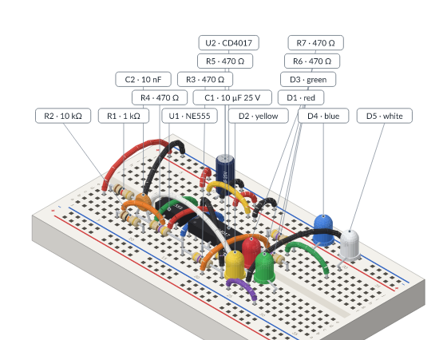 | **[555-cd4017-chaser.json](555-cd4017-chaser.json)**: a 555 astable clocks a CD4017 decade counter; five LEDs on Q0…Q4 light one after another and Q5 wired to MR resets it on the sixth count. Made by `layout` from [layout/555-cd4017-chaser.json](layout/555-cd4017-chaser.json). |
| 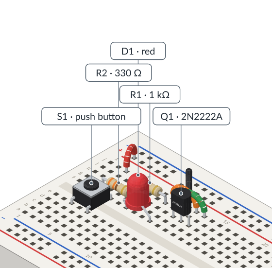 | **[npn-switch.json](npn-switch.json)**: the `npn-switch` recipe as laid out, with a tour ([tours/npn-switch.json](tours/npn-switch.json)): *See how it works* in the page's ⋯ menu presses S1 and follows the current to the LED. |

## Power

| | |
|---|---|
| 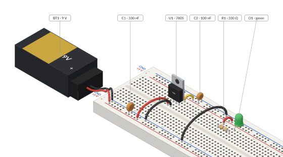 | **[battery-regulator.json](battery-regulator.json)**: a 9 V battery beside the board, a 7805 regulator with its capacitors and an LED. Batteries: chemistry, cells in series, state of charge. |
| 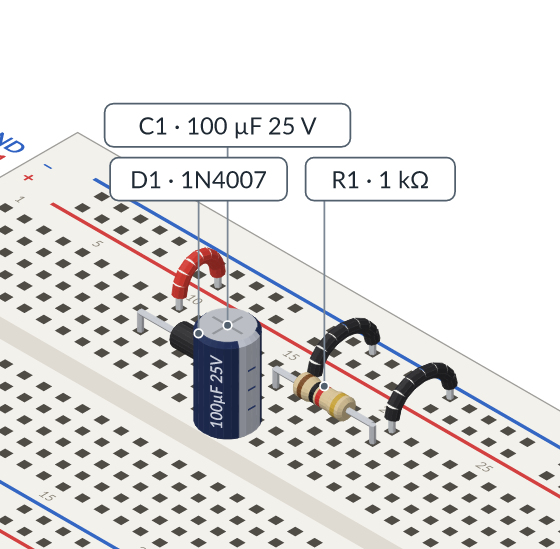 | **[half-wave-rectifier.json](half-wave-rectifier.json)**: one diode and a filter capacitor fed by a 50 Hz signal generator; the oscilloscope shows the ripple. |
| 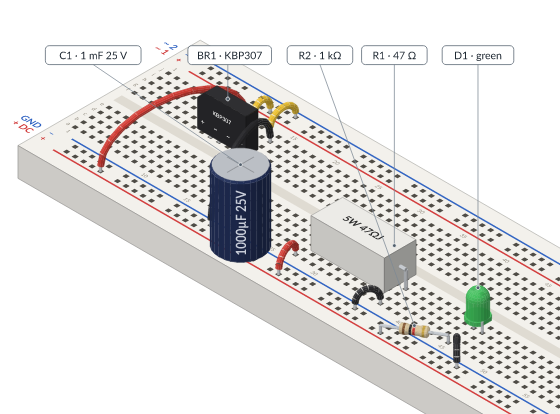 | **[rectifier.json](rectifier.json)**: a bridge rectifier, a filter capacitor, a 5 W cement resistor as the load and an LED. |
| 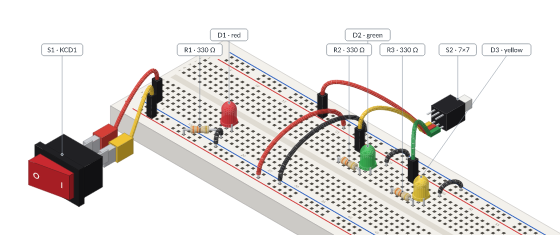 | **[switches.json](switches.json)**: a rocker switch on alligator clips and a latching switch, off the board; *On/Off* in the page. |
| 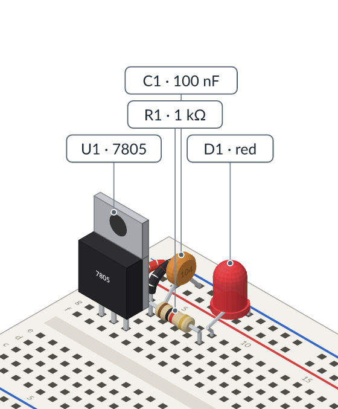 | **[layout/regulator-led.json](layout/regulator-led.json)**: a layout spec (parts and nets only): a 7805 and a pilot LED. |
| 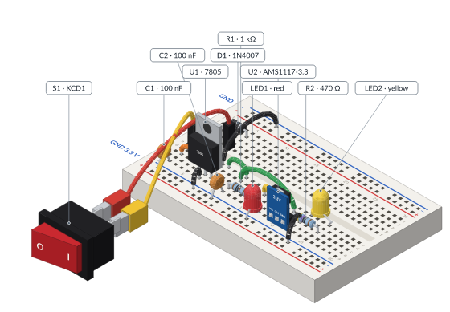 | **[layout/two-rail-supply.json](layout/two-rail-supply.json)**: a layout spec: 12 V through a protection diode and a power switch, a 7805 to 5 V, then an AMS1117 to 3.3 V, each with a pilot LED. |

## Signals in time

| | |
|---|---|
| 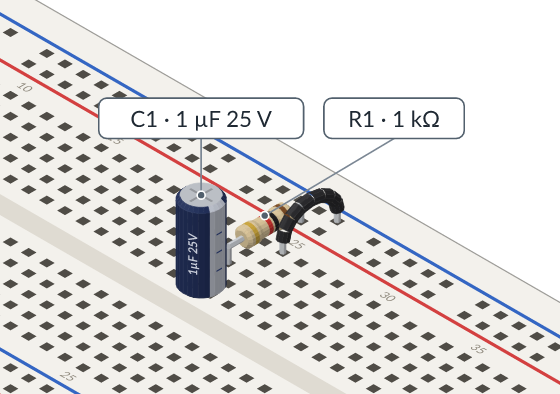 | **[rc-square-wave.json](rc-square-wave.json)**: a resistor and a capacitor charged by a square wave; compare the time constant with the period on the oscilloscope. |

## Sensors and the environment

| | |
|---|---|
| 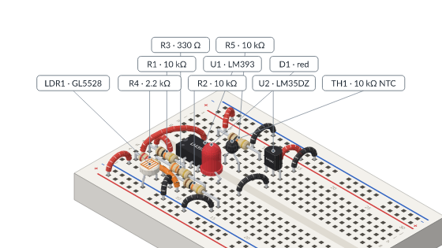 | **[environment.json](environment.json)**: a photoresistor into an LM393 comparator that lights an LED in the dark, an NTC divider and an LM35, all reading the circuit's shared environment (light and temperature in the page's *Environment* panel, each with its indicator); a tour ([tours/environment.json](tours/environment.json)) dims the light and warms the room. See [environment.md](../docs/en/environment.md). |
|  | **[environment-cycle.json](environment-cycle.json)**: the same circuit with the light in a slow cycle (a sine from 5 to 2000 lx every 8 s): the LED lights while it is dark; *Pause* and *Resume* in the panel. |
| 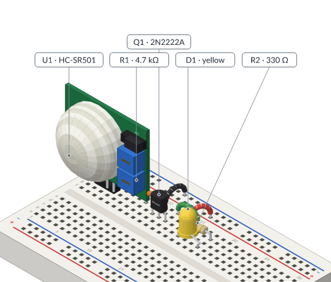 | **[pir-lamp.json](pir-lamp.json)**: the `pir-lamp` recipe as laid out, with a tour ([tours/pir-lamp.json](tours/pir-lamp.json)): move the motion switch and the lamp lights, stays on for the PIR's 5 s delay and goes out; motion right after is ignored for 2.5 s. See [timed-sensors.md](../docs/en/timed-sensors.md). |
| 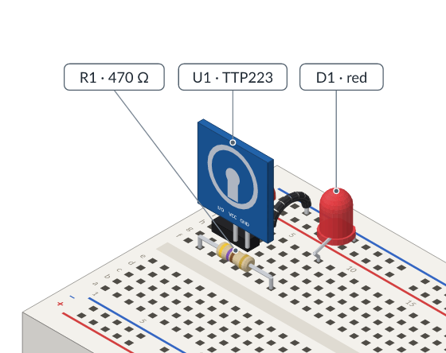 | **[touch-toggle-led.json](touch-toggle-led.json)**: the `touch-toggle-led` recipe as laid out, with a tour ([tours/touch-toggle-led.json](tours/touch-toggle-led.json)): each touch flips the LED, 220 ms after the finger; letting go does nothing. |
| 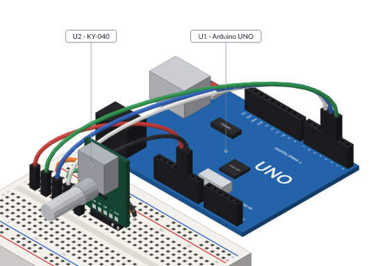 | **[encoder-uno.json](encoder-uno.json)**: the `encoder-uno` recipe as laid out, with a tour ([tours/encoder-uno.json](tours/encoder-uno.json)): turn the angle and the UNO counts the clicks, 5 clockwise for 90°, back to 2 at 36°; the push switch zeroes the count. See [rotary-encoder.md](../docs/en/rotary-encoder.md). |
| 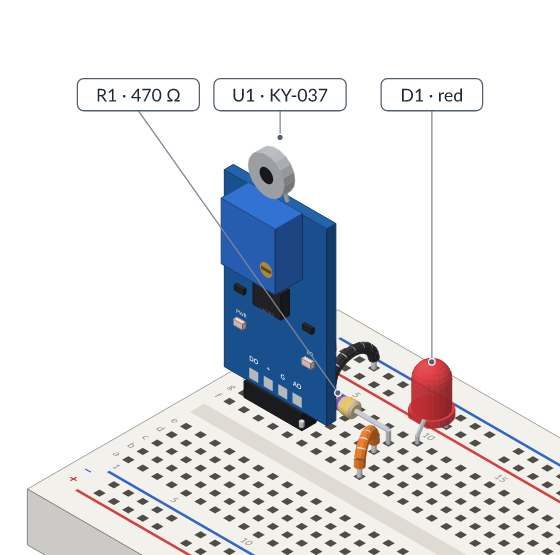 | **[sound-level-led.json](sound-level-led.json)**: a KY-037 sound module whose DO sinks an LED's current while the sound is loud (in the model: which way DO moves on the real board is not confirmed, so it is not a recipe for now). |

## Microcontrollers

| | |
|---|---|
| 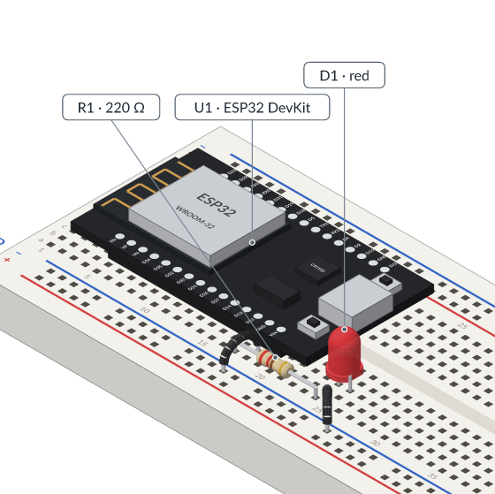 | **[esp32-led.json](esp32-led.json)**: an ESP32 DevKit over the centre channel lights an LED from D13 (the pin's state set in `io`). On USB it is the source. |
| 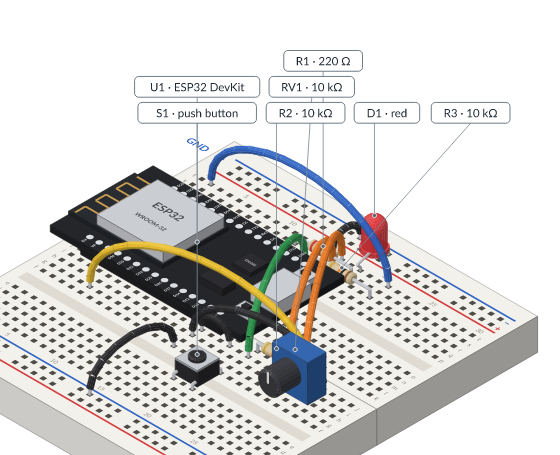 | **[esp32-two-boards.json](esp32-two-boards.json)**: an ESP32 DevKit with nets on both pin headers, laid out on two breadboards side by side (board `double`), across the joint, so each header keeps a free strip: an LED on D4, a button on D15, a potentiometer on D34. Made by `layout` from [layout/esp32-both-headers.json](layout/esp32-both-headers.json). |
| 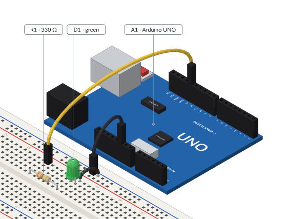 | **[uno-led.json](uno-led.json)**: an Arduino UNO beside the board, Dupont leads to an LED on D13. |
| 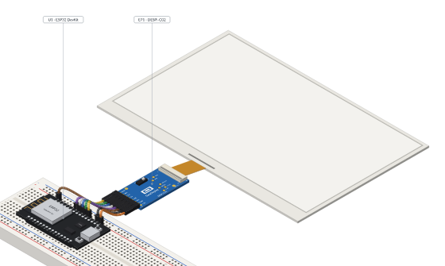 | **[epaper-esp32.json](epaper-esp32.json)**: an ESP32 driving a 7.5" e-paper panel through the DESPI-C02 adapter. |
| 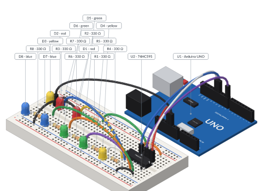 | **[uno-74hc595-fill.json](uno-74hc595-fill.json)**: an Arduino UNO fills eight LEDs through a 74HC595 shift register with `shiftOut` (three pins for eight outputs: SER, SRCLK, and RCLK to latch). Made by `layout` from [layout/uno-74hc595-fill.json](layout/uno-74hc595-fill.json). |

Programs (Arduino sketches that run in the simulation) are in the microcontroller recipes:
[microcontrollers.md](../docs/en/microcontrollers.md).

## The catalog

| | |
|---|---|
| 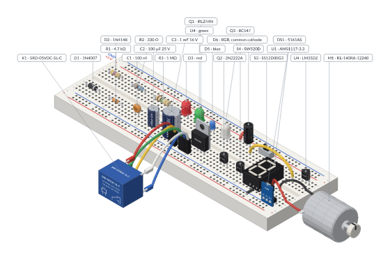 | **[parts-showcase.json](parts-showcase.json)**: resistors (5 % and 1 %), diodes, LEDs (one RGB), capacitors, transistors, an AMS1117 module, a 7-segment display, slide and tilt switches, an LM35, and beside the board a relay and a DC motor, with jumpers. Its notes about unconnected pins are expected. |
| 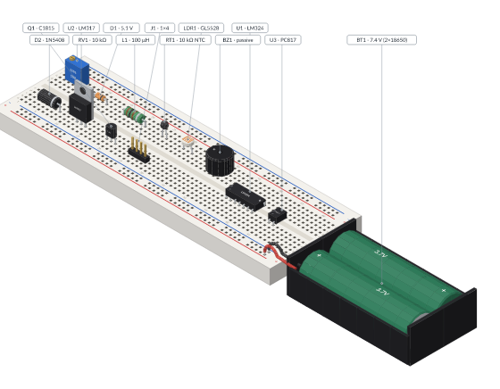 | **[more-parts.json](more-parts.json)**: trimmer, Zener, inductor, thermistor, LDR, buzzer, header, LM324, LM317, PC817 and lithium cells. |

## Analog chips

| | |
|---|---|
| 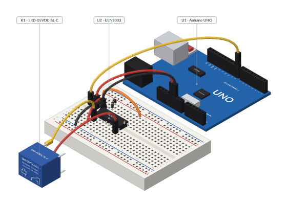 | **[uln2003-relay.json](uln2003-relay.json)**: a UNO's D8 drives channel 1 of a ULN2003, whose OUT1 sinks the relay coil's current from 5 V; COM on the same 5 V is the coil's flyback diode. The relay pulls in for a second and drops for a second. |
| 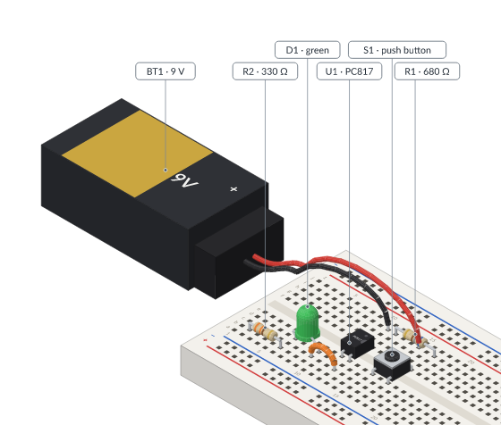 | **[pc817-isolated-led.json](pc817-isolated-led.json)**: a button on a 9 V battery lights the PC817's infrared LED through 680 Ω; its phototransistor sinks a green LED's current from a 5 V supply. The two sides share no wire and each has its own ground; press the button in the page. |
| 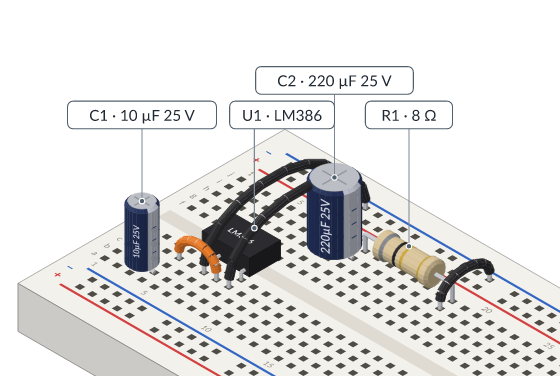 | **[lm386-amplifier.json](lm386-amplifier.json)**: the generator's 1 kHz, 50 mV wave through 10 µF into an LM386 with pins 1 and 8 open (gain 20); the 8 Ω load gets about 1 V peak through 220 µF, around the 4.5 V the output rests at. The 8 Ω resistor stands for a speaker, which the kit does not have yet. |

## Wrong on purpose

| | |
|---|---|
| 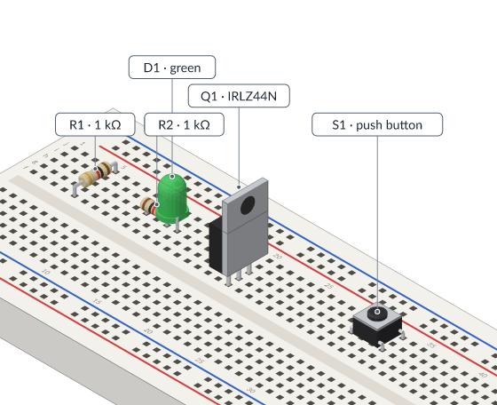 | **[common-mistakes.json](common-mistakes.json)**: **this circuit is wrong on purpose.** Each part makes a usual mistake, and `check` reports every one: two leads in one hole, a resistor shorted along one strip, a transistor with its three pins in one strip, a button that is always closed, leads too close for the body. Run `node bin/protoboard-iso.js check examples/common-mistakes.json` and compare. |

## Adding an example

A new example is a circuit file here that `check` passes (unless it shows mistakes on purpose)
with a `title` in English and Spanish. Then `node scripts/readme-images.js examples/` draws its
thumbnail, and it gets a row in this file and in [README.es.md](README.es.md).
